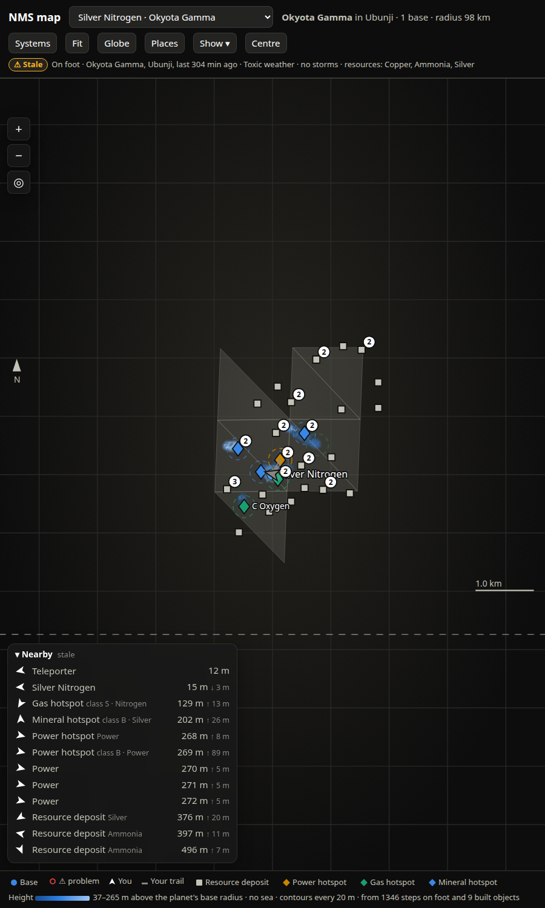
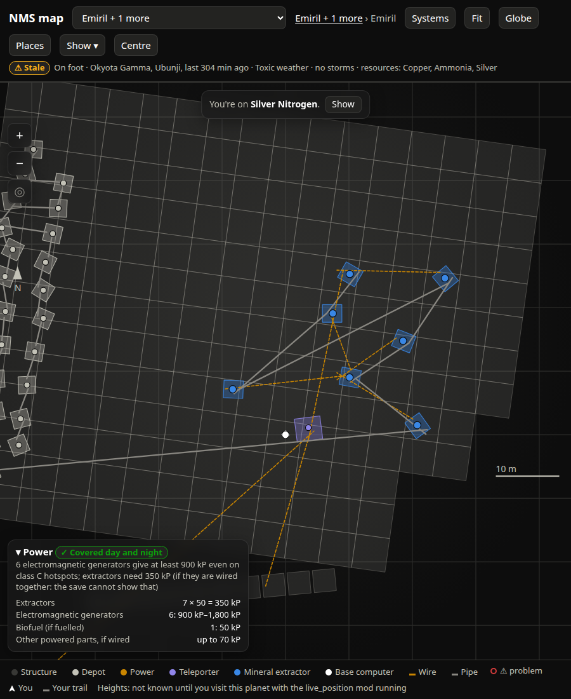
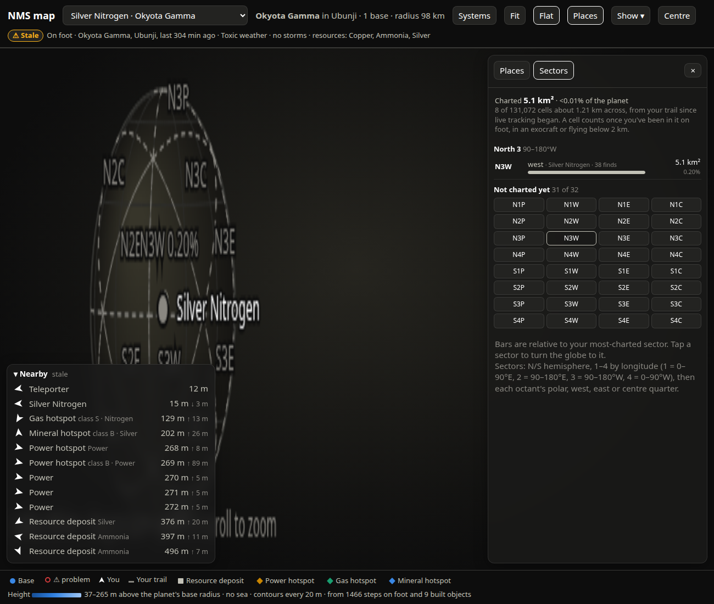
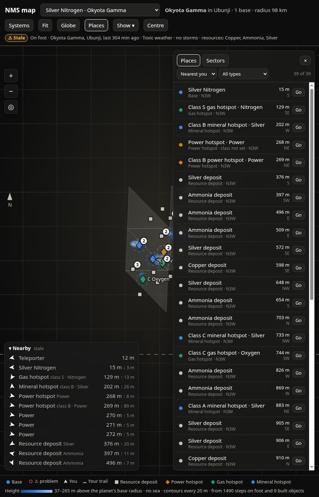

# nms-exporter-spec

The specification for a No Man's Sky companion built around the save file and a live hook into
the running game: Prometheus metrics and wall screens from the save, and a browser map of your
planets, bases, resource finds and charted ground, fed live from the game at 4 Hz.

This repository holds **no code**. It is the set of specs, decisions and lessons from building
the thing once, written so that someone else can rebuild it with an AI coding agent (Claude Code
or similar) on their own machine, with none of the original's infrastructure. Where the original
leaned on a home lab (a Kubernetes cluster, a managed Postgres, a secret store), the spec says
what is needed from such a thing and why, not which product or host.

## What it does

- **Save exporter.** Reads the newest save, serves it as Prometheus metrics and JSON: farms and
  their fill levels projected forward in time, refiners, the planner ("what can I craft after a
  harvest"), plants, missions, technology, frigates, portal glyphs. A Grafana dashboard and two
  portrait wall screens consume it. Versioned save backup to an S3-compatible bucket.
- **Game data.** Tools that unpack the game's own files for the tables the exporter needs
  (hotspot classes and rates, biome gases, recipes), HUD icons and portal glyphs for the map,
  per-part collision footprints so bases can be drawn to scale, and a one-value loose-file mod
  (freighter Harvest All radius). The extracted art stays on your machine; it is Hello Games'.
- **Live hook.** Python injected into the running game (pyMHF/NMS.py, under Proton) writes your
  position, heading, planet, weather and storm state four times a second, logs what the analysis
  visor finds and every star system you classify, and takes `/hs`, `/mark`, `/help` commands in
  the game's chat.
- **Map.** A browser page (phone, fold, desktop) with the planet projected flat or as a globe:
  your trail and heading, bases drawn from their real footprints, terrain heights from where you
  have been, hotspots with the class you recorded, a power check per base, storm countdown,
  32 sectors with how much of each you've charted, a sortable list of every place with
  waypoints, and a page of every star system seen with its portal address.
- **Storage.** Everything that is not in the save goes to Postgres: the hook's event streams,
  your labels, planet facts, with typed views for ad-hoc queries. Machine identity for secrets
  with no human in the loop.

## Rebuilding it

Start at **[`docs/reproduce.md`](docs/reproduce.md)**: prerequisites, the order to build in, and
what to verify after each step. Then the specs by area:

| area | what | specs |
|---|---|---|
| save-exporter | save decoding, metrics, farms, planner, Grafana, wall screens, backup | `spec/snapshot/SPEC-00[01-19]-*` |
| game-data | unpacking paks, tables, icons, glyphs, footprints, a loose-file mod, the compendium method | `SPEC-00[20-39]` |
| live-hook | injection under Proton, the launcher, the mods, hot-patching, frames, storms, hotspots | `SPEC-00[40-59]` |
| map-ui | the map and systems pages | `SPEC-00[60-79]` |
| storage-deploy | Postgres store, environment, service, machine identity, exposure | `SPEC-00[80-99]` |

[`spec/ROADMAP.md`](spec/ROADMAP.md) lists every spec with its status. `spec/decisions/` says
why things are the way they are; **`spec/lessons/`** is the part to read first if you only read
one: each area's gotchas, ordered by how much time they would have saved.

Shared formats (save fields, universe address packing, the hook's event lines, the database
schema) are in [`docs/data-formats.md`](docs/data-formats.md); the map's HTTP API in
[`docs/map-api.md`](docs/map-api.md); every event the hook writes in
[`docs/hook-events.md`](docs/hook-events.md).

## What you need

- A PC that runs No Man's Sky (the original is Linux + Steam/Proton; the hook assumes that) and
  can run Python 3.12+ unattended.
- Somewhere for the map's history: a Postgres you can reach from that PC. The original uses a
  managed Postgres in a Kubernetes cluster; a single local instance works for the spec.
- Optional: Prometheus-compatible storage and Grafana for the save metrics; an S3-compatible
  bucket for save backups; a secret store with machine roles if you want unattended credentials.

## Safety

The live hook injects into a running game process. It can crash the game; a second attach in one
game run **will**. Save before attaching, read `spec/lessons/` for the live-hook area, and keep
the hook's rules: attach once per run, never Ctrl-C its terminal, hot-patch only logic over
memory already proven safe.

## Screenshots

Every screenshot was taken with the extracted HUD icons, portal-glyph images and glyph font
absent, so what you see are the map's own fallback marks (dots and diamonds, hex digits for
glyphs). That is deliberate: no image here contains game art. With the art extracted locally
(SPEC-0023) the map shows the game's icons instead. `database-down.png` shows the banner the map
raises when its history store is unreachable (SPEC-0081).

## Licence

MIT for this repository's text. Game data facts recorded here are from the game's own files;
no game assets are included or may be redistributed.
