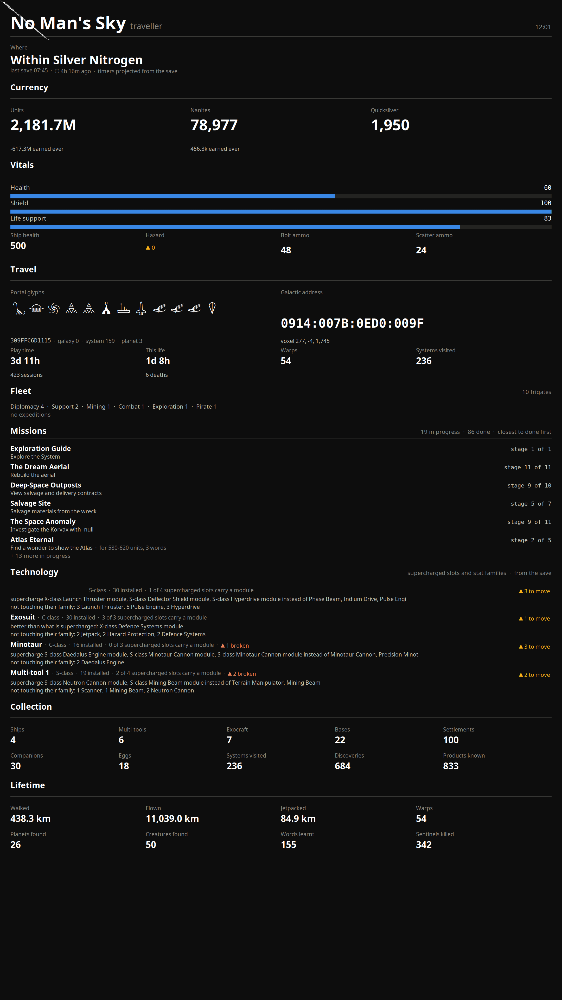
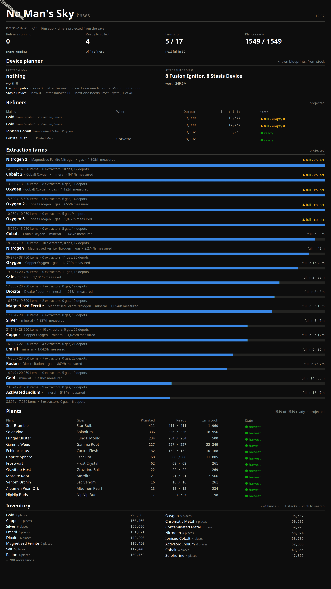

# SPEC-0009: Conky wall screens: traveller and bases

## Summary

Two portrait monitors flank the one the game runs on. The left one, **traveller**, shows where
the player is, money, vitals, travel (portal glyphs drawn as the game draws them, galactic
address), the frigate fleet, missions closest to done, the technology placement review,
collection and lifetime counters. The right one, **bases**, shows a summary strip, the device
planner, refiners, extraction farms, plants by kind, and the largest inventory stacks with a
click-to-search. Both are conky windows whose text is produced by one Python renderer called once
per section through `${execpi}`; all numbers come already projected from the exporter's `/json`
on loopback, so the screens keep counting between autosaves. Both carry the save's age, because
every timer on them depends on it.

 

(Rendered in Xvfb at `-dpi 96` from a live save; player-chosen ship and freighter names are
blanked.)

## Inputs and outputs

| Input | Default | Override |
|---|---|---|
| Data | `http://localhost:9877/json` | `NMS_CONKY_URL` |
| Fetch cache | `$XDG_RUNTIME_DIR/nms-conky.json` | - |
| Search state | `$XDG_RUNTIME_DIR/nms-conky-search.json` (`{query, at}`) | - |
| Palette | `conky/palette.css` (CSS custom properties) | - |
| Monitor | leftmost / rightmost xrandr monitor | `NMS_CONKY_OUTPUT` (output name) |
| Text scale | 0.8 of design sizes | `NMS_CONKY_TEXT_SCALE` |

Renderer CLI: `nms_conky.py left|right <section>`; sections:
`left: head where money vitals travel fleet missions tech collection lifetime`,
`right: head summary planner refiners farms plants inventory` (plus `crafting` and `tidy`, which
render but are left off the screen so the search stays in view).

## Requirements

### SPEC-0009-REQ-001: Canvas

Each screen shall lay out for exactly **2160 x 3840** pixels (a rotated 4K panel as an X11 client
sees it), 40 px margins, content width 2080. Conky window: `own_window_type normal`, hints
`undecorated,below,sticky,skip_taskbar,skip_pager`, opaque with the page colour, double-buffered,
`alignment top_left`, `gap_x = gap_y = 40`, `minimum_width = maximum_width = 2082`,
`minimum_height = 3763`, `border_inner_margin = 40`, `update_interval 2`,
`text_buffer_size 32768`, `max_user_text 65536`, Xft font `Noto Sans:pixelsize=30`.

### SPEC-0009-REQ-002: One renderer call per section

The config shall stitch sections with `${execpi 5 <renderer> <side> <section>}` separated by
`${voffset 24}` (10 after the head); the inventory section uses `execpi 2` so a search shows
quickly. Each call prints conky markup for one section and exits 0.

### SPEC-0009-REQ-003: Shared fetch cache

All sections of one refresh shall share one fetch: the renderer reads the cache file; if it is
older than **TTL = 4 s** it fetches `/json` (timeout 3 s), drops the large `known` key, and writes
`{fetched, good, error, data}` via a temp file + rename. On a fetch error it keeps the previous
`data` and `good` time and records the error. If there is no data, or the last good fetch is
older than **120 s**, the renderer returns "no data" rather than old numbers.

A fetch inside `execpi` blocks that one section for up to the 3 s timeout when the exporter
hangs. A rebuild should refresh the cache from a background process instead, so `execpi` only
ever reads a file (the companion wall-screen project does this); the reference implementation
does not yet.

### SPEC-0009-REQ-004: Never blank, never a traceback

The renderer shall catch every exception. The `head` section always renders: title, subtitle,
clock, and a note when the exporter is unreachable (`critical`), when showing data N old after a
failed fetch (`warning`), or one note per entry in the payload's `errors` map. Other sections
render empty when there is no data (the head already says why) and a one-line critical note
naming the section if their own code fails.

### SPEC-0009-REQ-005: Save age line

Both screens shall show `last save HH:MM · <age> ago · timers projected from the save`, the age
pill `good` under 15 minutes and `idle` beyond.

### SPEC-0009-REQ-006: Visual rules

- Colours only from `palette.css`: page `#0d0d0d`, surfaces `#1a1a19` / `#232321`, ink
  `#ffffff` / `#c3c2b7` / `#898781`, grid `#2c2c2a`, axis `#383835`, series-1 `#3987e5`
  (others reserved), status `good #0ca30c`, `warning #fab219`, `serious #ec835a`,
  `critical #d03b3b`. The Lua configs and the renderer parse the same file.
- Status hues are for state only; magnitude bars are series-1 blue until a threshold is actually
  crossed (default 0.75 / 0.88 / 0.95; vitals invert it because low is the problem).
- Status is never colour alone: every state is a pill of glyph + word (`● ready`,
  `▲ full - empty it`, `✖`, `○ empty`). Glyphs are drawn in DejaVu Sans because Xft does no font
  fallback and Noto Sans lacks them.
- Values wear ink tokens, never a series colour. A full farm is a to-do, not an alarm: its bar
  stays blue and the pill carries the state.
- Bars are runs of `█` in DejaVu Sans Mono (advance 0.602 em), cell count from the width.
- Numeric table columns are right-aligned by monospace padding; `$` and `#` in text are escaped
  (`$$`, `\#`).

### SPEC-0009-REQ-007: Section content (bases)

- summary: refiners running (next done in), ready to collect, farms full `n / total` (next full
  in), plants ready `mature / total`.
- planner: "Craftable now" and "After a full harvest" with value, then one line per target with
  the next-unit blocker (SPEC-0006).
- refiners: running first, soonest done at top, then finished fullest first; columns Makes (with
  inputs), Where, Output, Input left, State (progress bar + time, or pill); top 10.
- farms: sorted by time to full; name, base, kind, rate with `measured` / `assumed C-class`, a
  full-width bar, `items / capacity` and counts.
- plants: one row per kind: Gives, Planted, Ready, In stock, State.
- inventory: top stacks in two columns with "N places"; when a search is active, every match per
  container, plus a matching known blueprint's ingredients with have-counts and where they are.

### SPEC-0009-REQ-008: Click to search

conky 1.22's mouse hook never receives clicks under XInput2, so `right.conf` shall start a
watcher (`nms_search.py --watch`, Xlib + libXi via ctypes) that reads raw button events on the
root window and acts when the window under the pointer has class `nms-conky-right`: left-click
opens a `kdialog` input box and writes the query, right-click clears it; a query reverts after
15 minutes; the watcher exits with conky. `nms_search.py <term>` and `--clear` work from a
terminal.

### SPEC-0009-REQ-009: DPI compensation

conky multiplies every pixel setting (`gap_*`, sizes, margins, `${goto}`, `${voffset}`,
`${offset}`, graph sizes) by `Xft.dpi / 96` but **not** font pixel sizes. The configs shall read
`Xft.dpi` from `xrdb -query`, divide every such value by `dpi / 96` (rounded), and pass the factor
to the renderer as `CONKY_DPI_SCALE` so it does the same to its `${goto|voffset|offset}`.

### SPEC-0009-REQ-010: Window placement

The config picks the Xinerama head from `xrandr --listmonitors` (leftmost x for left, rightmost
for right, or the one named by `NMS_CONKY_OUTPUT`) and sets window class `nms-conky-left` /
`nms-conky-right`. On KDE, window rules matched by class shall force position (any point inside
the target monitor, in KWin logical coordinates) and fullscreen, below, no border, skip
taskbar/pager/switcher, all desktops: KWin ignores an X11 window's requested position and clips X11
windows to `_NET_WORKAREA`, which a panel on any monitor shortens. Match by layout position, not
screen index: KWin renumbers outputs between boots.

### SPEC-0009-REQ-011: Portal glyph font

The travel section draws the 12-character portal code in a font whose `0-9 A-F` are the 16 portal
glyphs (fontconfig family `NMS Glyphs`, style `Glyphs-Mono`), installed system-wide. That font is
a community-made file, not a game asset; get it from the community tools it ships with, or build
one from the glyph icons the `game-data` area extracts.

## Degraded behaviour

| Condition | Screen shows |
|---|---|
| Exporter unreachable, no cached data | Head with `✖ exporter unreachable at <url> - <error>`; sections empty |
| Exporter unreachable, cache < 120 s old | Last numbers plus `▲ showing data Ns old - <error>` |
| Payload `errors` non-empty | One `▲ source: message` line per error under the head |
| Save old (game closed) | Age pill turns idle; projected timers keep counting to their caps |
| Section bug | `✖ <section>: <Exception>` in place of that section only |
| No refiners / farms / plants | "no refiners in the save", "no extraction farms", "nothing planted" |
| `kdialog` missing | Clicks do nothing; terminal search still works |

## Verification

Render each screen in Xvfb at **96 dpi** (Xvfb defaults to 100, which conky treats as a 4%
scale-up and pushes the layout off the edge):

```bash
XDG_RUNTIME_DIR=$(mktemp -d) NMS_CONKY_URL=http://localhost:9878/json \
  xvfb-run -a -s "-screen 0 2160x3840x24 -dpi 96" \
  sh -c 'conky -c right.conf & sleep 20; import -window root right.png; kill $!'
```

Look at the image: nothing clipped on the right, the last section ends above the bottom edge, no
`--` where a value should be. Then stop the exporter and render again: the head explains, nothing
else is blank or zero. Kill the search watcher by PID afterwards, not by a pattern that can match
your own shell.

## Lessons

See [SPEC-0019](../lessons/SPEC-0019-save-exporter-lessons.md): Xft.dpi 124 under XWayland pushed
the layout ~29% past the right edge; conky's mouse hook misses clicks under XInput2; KWin ignores
X11 positions and clips to the work area.
