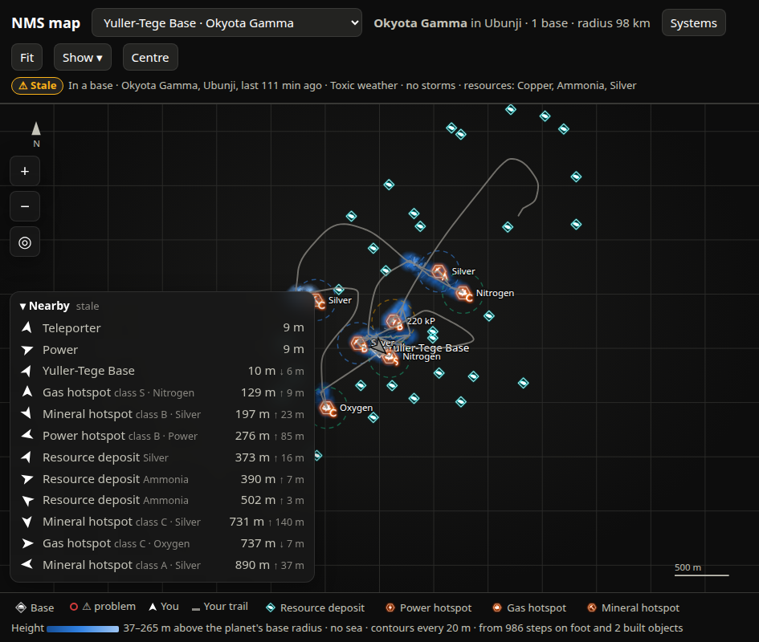
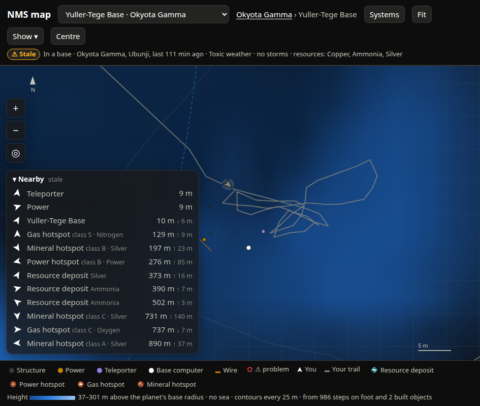
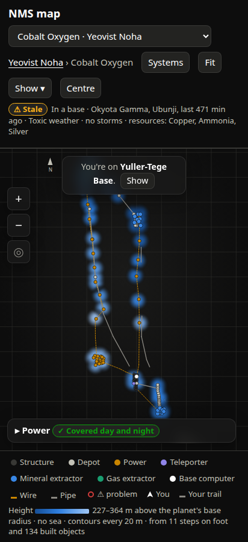
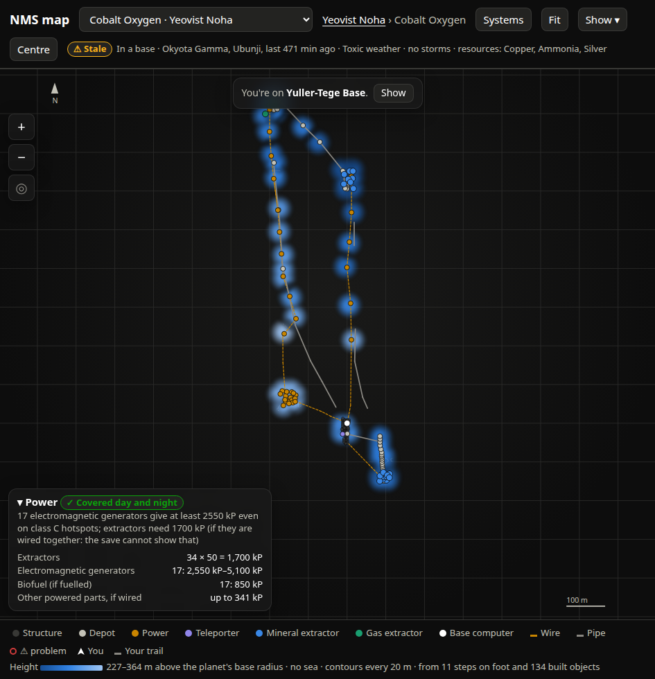

# SPEC-0060: Map page: views, coordinate frames and projections

## Summary

`/map` is a single self-contained HTML page served by the exporter. It shows one planet at a
time, in one of two views:

- **Planet view**: every base, exocraft, settlement and drained deposit on the planet (from the
  save), plus visor finds, sectors, heights and the live player (from the live hook's history),
  laid out on an **azimuthal equidistant projection** centred on the planet's bases, so distance
  and bearing from the centre are true.
- **Base view**: one base's layout, top-down, in **metres from the base computer, rotated
  north-up**: extractors, depots, power parts, refiners, teleporters, plants, structures, pipes,
  wires and wire teleports, with loose extractors flagged.

Everything else in the map-ui area (live layer, heights, finds, globe, footprints, sectors) is a
layer drawn into one of these two frames. This spec defines the frames, which every other layer
depends on, and the page shell that holds them.





## Inputs and outputs

- Reads: the parsed save (bases with `Position`, `Forward`, `GalacticAddress`, `Objects`;
  vehicles; drained deposits; settlements), see the save-exporter area (SPEC-0001–0019).
- Reads: the game tables (base-building table for power, extraction table), see game-data
  (SPEC-0020–0039).
- Reads: planet/system names, visited base-less planets and tile colours from the history store
  (live-hook area SPEC-0040–0059, storage SPEC-0080–0099).
- Serves: `GET /map` (HTML), `GET /api/map` (JSON). Shapes in [docs/map-api.md](../../docs/map-api.md).
- The page is read from disk on every request, so an edited page needs no restart.

## Requirements

### SPEC-0060-REQ-001: Planet-centred frame

The system shall treat a planetary base's `Position`, exocraft positions, drained-deposit
positions and the live player's `rel` as vectors from the **planet centre** in one shared frame,
in metres. North shall be the planet's **+Y axis**; at a unit position `u` on the sphere:

```
north = normalise(Y - (Y·u) u)        (fallback [1,0,0] at a pole)
east  = normalise(north × u)
```

This was measured in game (facing east on the compass gave a bearing of 89.4°), so the page
shall show the north arrow as `N`, not `N?` (`north_verified: true`).

### SPEC-0060-REQ-002: Which points belong to a planet

The system shall group bases by `GalacticAddress` (an int, or a hex string parsed base 16) and
shall skip bases whose `BaseType.PersistentBaseTypes` is `FreighterBase`, `PlayerShipBase` or
`PlayerSpaceBase` (the freighter and corvette are "bases" wherever they happen to be). An
exocraft, drained deposit or settlement shall be placed on a planet only when its address matches
and `| |p| - radius | < 0.03 × radius`; anything else is in a different frame and is dropped.

### SPEC-0060-REQ-003: Planet projection

The planet view shall use an azimuthal equidistant projection with:

- centre `c` = normalise(sum of the planet's base `Position`s);
- radius `R` = mean of `|Position|` over those bases (for a base-less planet see REQ-004).

A point `p` maps to map metres `(x east, y north)`:

```
u    = normalise(p)
ang  = acos(clamp(u·c, -1, 1))
if ang < 1e-9: (0, 0)
t    = normalise(u - (u·c) c)
dist = R × ang
x    = dist × (t·east_c),  y = dist × (t·north_c)      # east_c, north_c from REQ-001 at c
```

Distances and bearings from the centre are true; distances between two off-centre points are not
(the globe, SPEC-0065, exists for that).

### SPEC-0060-REQ-004: Planets without bases

Where the player has visited a planet with the live hook running but has no planetary base there,
the system shall add it to `/api/map` with `bases: []`, `visited: true`, and a projection centred
on the **first surface sample** ever recorded on it, with the planet's **nominal radius** as `R`
(the value most samples agree on, see SPEC-0062-REQ-002). The centre shall be stable across
visits. Its label shall be `"<planet name> in <system name> (no bases)"`, falling back to
`Planet <n>` / `system <n>` from the address when names are unknown.

### SPEC-0060-REQ-005: Base-local frame

A base's objects are stored in the base's own frame: object `(x, y, z)` means
`x → Right, y → Up, z → Forward`. The system shall build the axes as:

```
up      = normalise(base.Position)
forward = normalise(F - (F·up) up)    where F = base.Forward (default [0,0,1])
right   = up × forward
world(p) = base.Position + right·p.x + up·p.y + forward·p.z
local(w) = [(w-P)·right, (w-P)·up, (w-P)·forward]
```

If `up` or `forward` normalise to nothing, the base has no layout.

### SPEC-0060-REQ-006: base_en (base view coordinates)

The base view shall map a base-local position to `(east, north, height)` in metres from the base
computer (`^BASE_FLAG` object; origin `[0,0,0]` if absent), rotated north-up:

```
north, east = tangent frame at `up` (REQ-001)
rx, rz = right·east,  forward·east
nx, nz = right·north, forward·north
x, z   = p.x - flag.x, p.z - flag.z
east   = rx·x + rz·z          (rounded 0.01 m)
north  = nx·x + nz·z          (rounded 0.01 m)
height = p.y - flag.y         (rounded 0.1 m)
```

Any world point (live player, a find) is shown in the base view as `base_en(local(w))`.

### SPEC-0060-REQ-007: Object kinds

Base objects shall be classified by `ObjectID`:

| ObjectID rule | kind |
|---|---|
| mineral / gas extractor IDs | `extractor-mineral` / `extractor-gas` |
| `^U_SILO_S` | `depot` |
| `^U_GENERATOR_S`, `^U_BIOGENERATOR`, `^U_SOLAR_S`, `^U_BATTERY_S` | `power` |
| contains `REFINER` | `refiner` |
| `^TELEPORTER`, `^U_MINIPORTAL` | `teleporter` |
| `^BASE_FLAG` | `computer` |
| contains `PLANTER`, starts `^PLANT`, contains `BIOROOM` | `plants` |
| anything else | `structure` |

`^U_PIPELINE`, `^U_POWERLINE`, `^U_PORTALLINE` are **segments** (`pipe`, `wire`, `link`) from
`Position` to `Position + At`, not items. Each item carries `e, n, h`, its `id` (ObjectID without
`^`), its object index `i` (so it can be targeted as `o:<base>:<i>`), and when the extractor
check flags it, `problems`, `fill`, `pipe_gap`, `near` (the check is save-exporter's).

### SPEC-0060-REQ-008: Planet list and labels

`/api/map` shall list planets sorted by number of bases, most first. Each planet's `label` is its
base name when it has one base, else `"<first name A-Z> + <n> more"`. Each planet carries
`planet_name`, `system_name`, `portal` (SPEC-0068-REQ-006) and `tile_colours` when known. The
picker option text shall be `label`, then ` · <planet name>` for planets with bases, then ` ⚠`
when any base on it has a loose extractor.

### SPEC-0060-REQ-009: Default view on load

When the page loads without URL parameters, it shall open the first planet with a loose
extractor, else the first planet. When a planet has exactly one base, choosing it shall open that
base's layout directly; otherwise the planet view. Breadcrumbs shall read
`<planet name or label> › <base>` in base view (the planet part a link back), and
`<planet> in <system> · <n> bases · radius <r>` in planet view.

### SPEC-0060-REQ-010: URL parameters

The page shall accept:

| param | effect |
|---|---|
| `?base=<name>` | open the planet holding that base, in that base's layout |
| `?planet=<text>` | open the planet whose base names include it, or whose `planet_name` or `label` equals it, or whose label starts with `<text> ` (so `Okyota Gamma` opens `Okyota Gamma in Ubunji (no bases)`); planet view |
| `?at=e,n,w` | after rendering, zoom so the view is `w` metres wide centred on `(e, n)` in the current view's frame |
| `?sheet=places` / `?sheet=sectors` | open the Places sheet on that tab (SPEC-0067) |
| `?globe=1` | open the globe (SPEC-0065) |

A URL that chose a view shall stop the live layer from moving the page to the player's planet on
first sight (SPEC-0061-REQ-008), but `Centre` still follows.

### SPEC-0060-REQ-011: Fitting the view

On render the view shall fit its content: planet view pads 25 % and is at least 3000 m across
(600 m around the player or the origin when the planet has no points); base view pads 6 % and is
at least 40 m across. Fit shall keep content out from under the bottom dock panels: a panel that
reaches into the middle third of the map's width hides `main.bottom - panel.top` pixels, and fit
centres content in what is left (unless that cover would exceed 60 % of the height, in which case
it is ignored). The `Fit` button re-renders and refits.

### SPEC-0060-REQ-012: Map units in SVG

The SVG `viewBox` shall be in map metres with east right and north up: a point `(x, y)` is drawn
at SVG `(x, -y)`, and the viewBox is `x, -(y+h), w, h`. Marks, strokes, labels and icons shall be
sized in **screen pixels** and rescaled on every zoom (`k = view.w / main.width` metres per pixel).

### SPEC-0060-REQ-013: Planet tint and vignette

The map shall sit on a radial vignette (`ellipse at 50% 42%`, `--surface-1` to `--page` at 72 %).
When the planet's `tile_colours` (23 RGB triples, 0–1) are known, the vignette's centre shall mix
in their average at 22 % (`color-mix(in srgb, <avg> 22%, var(--surface-1))`). The tint is
ambience only: nothing is encoded in it and no data mark takes its colour.

### SPEC-0060-REQ-014: Page layout

The page shall be a three-row grid: a wrapping header (title, planet picker, breadcrumbs,
`Systems` link, `Fit`, `Globe`, `Places`, `Show ▾`, `Centre`, live pill, note), the map, and a
wrapping legend footer. Map overlays: zoom controls top-left, details panel top-right, away banner
top-centre, Places sheet on the right, and a bottom dock of up to three cards (problems, power,
nearby) that wraps upward. The header and footer shall wrap at phone width (≈ 400 px) without
horizontal scrolling.



## Degraded behaviour

- **No live hook / history store down:** `/api/map` still answers 200 with every planet that has
  bases; base-less planets (which come only from the history) are missing, and
  `errors["nms-db"]` says why. The page shows the database-down banner (SPEC-0069-REQ-010).
- **Base with no usable Position/Forward:** `layouts[name]` is `null`; the base view says
  "No layout for this base".
- **No planets at all:** the picker is empty; nothing else is drawn.
- **Name tables empty:** labels fall back to base names and address-derived `Planet <n>`.

## Verification

- Put two bases on opposite sides of a planet (or synthesise them): the planet view centres
  between them, and each base's `(x, y)` distance from the centre equals `R × angle` to within
  rounding.
- Stand at a base computer in game, face north on the compass, walk: the live arrow points up
  in the base view and the trail runs up the screen (SPEC-0061).
- Adjacent floor tiles in the base view share exact corners (SPEC-0066 relies on `base_en`).
- `?planet=<planet name>` opens a base-less planet; `?base=<name with spaces>` opens that base.
- `?at=0,0,60` in a base view opens 60 m across centred on the base computer.
- At 412 × 900 and at a ~945 px fold width the header wraps and nothing scrolls sideways.



## Lessons

See [SPEC-0079](../lessons/SPEC-0079-map-ui-lessons.md). Top two: the corvette and freighter are
bases in the save and must be skipped or a base-less planet looks based; `?planet=` has to match
planet names and label prefixes, not just base names.
