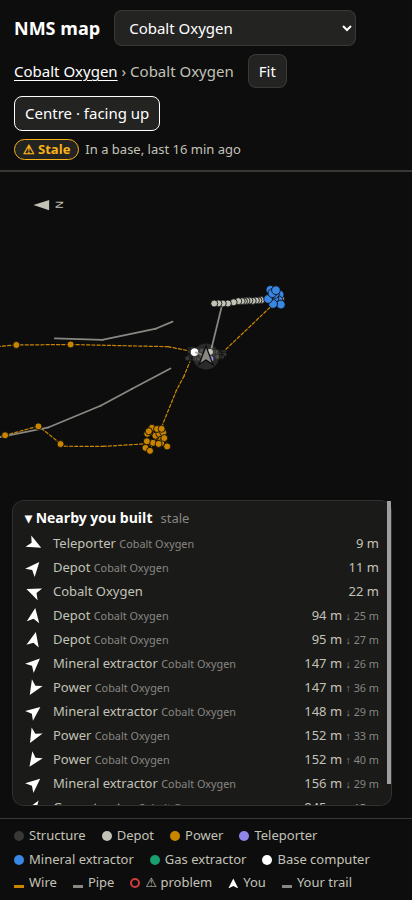
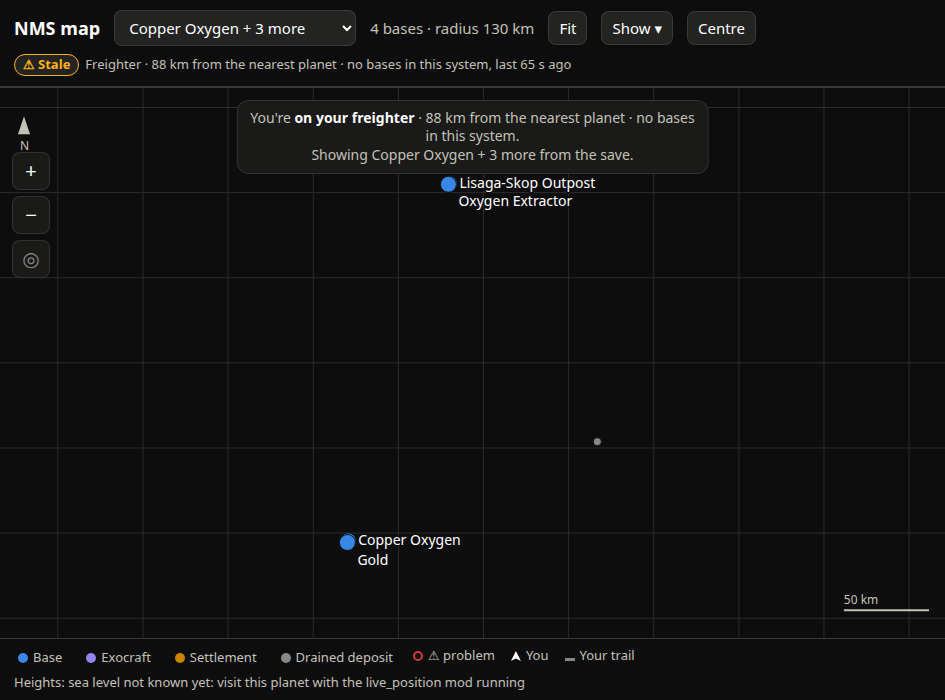
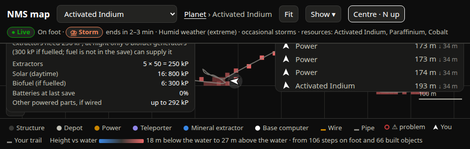

# SPEC-0061: Map live layer: position, heading, trail, follow, nearby and go-to

## Summary

While the game runs with the live-position hook (live-hook area, SPEC-0040–0059), the hook writes
the player's position about four times a second to a `live.json` file and appends a trail row to
the history store. The map polls `/api/live` every 0.5 s and draws where the player is, which way
they face, where they have been, and a short list of what is near with arrows **relative to the
player's facing**, so the list reads like the game's own HUD. A `Centre` button keeps the player
centred, optionally rotating the map so the player always faces up. When the player is somewhere
the shown map can't place them (space, freighter, another planet) a banner says so.



## Inputs and outputs

- `live.json` fields used: `t` (epoch s), `ua` (galactic address dict: `voxel` [x,y,z],
  `reality`, `system`, `planet`), `rel` (player minus nearest planet centre, planet frame),
  `at` (player transform's at vector), `location` (environment location name),
  `distance_from_planet`, `in_atmosphere`, `planet_pos`, `weather`, `sealevel`.
- History store: trail rows (address, sample) for the last two days; see storage area.
- Serves `GET /api/live?base=<name>&target=<key>`; shape in [docs/map-api.md](../../docs/map-api.md).

## Requirements

### SPEC-0061-REQ-001: Address packing

The system shall pack the hook's `ua` into the save's `GalacticAddress` integer layout:

```
X & 0xFFF | (Z & 0xFFF) << 12 | (Y & 0xFF) << 24 | min(reality,0xFF) << 32
  | min(system,0xFFF) << 40 | planet << 52
```

and match the planet by **exact** address. Planet bits `(addr >> 52) & 0xF == 0` mean "in a
system, at no planet" and shall never be treated as a planet. If `ua` is missing (hook attached
mid-game) but `planet_pos` is present, the system shall look up the address previously seen with
the same rounded planet centre and set `address_inferred: true` (attach mode only; see SPEC-0040 launch mode).

### SPEC-0061-REQ-002: Live state

`state` shall be `none` when `live.json` is missing or unreadable (with `error` saying which),
`stale` when the sample is older than **STALE = 10 s**, otherwise `live`. The player counts as
on the surface when the planet bits are non-zero and (`in_atmosphere` or
`distance_from_planet <= 20000`).

### SPEC-0061-REQ-003: Heading

Heading shall be the compass bearing of the player's facing, projected onto the tangent plane at
`up = normalise(rel)`: `atan2(f·east, f·north)` in degrees 0–360. The facing vector is `-at` on
foot and `+at` when `location` is `PlanetInShip` or `Default` (the only ship locations in
nmspy's `EnvironmentLocation`; space flight reports `Default`) (measured: movement vs `at` averaged cos −0.94 over 304 on-foot steps and
+0.99 over 1042 ship steps). Heading is `null` when the projection vanishes.

### SPEC-0061-REQ-004: Surface navigation

For the player at `rel` and any planet-frame point `w`, the system shall report:

```
u1 = normalise(rel), u2 = normalise(w), r = |rel|
dist    = r × acos(clamp(u1·u2))                     # along the surface, at the player's radius
t       = normalise(u2 - (u1·u2) u1)
bearing = atan2(t·east(u1), t·north(u1)) mod 360
turn    = ((bearing - heading + 540) mod 360) - 180   # negative = left; null without heading
h       = |w| - r                                     # height difference
```

Distances shall be great-circle, never projected, so a base on the far side of the planet shows
its true distance.

### SPEC-0061-REQ-005: Poll

The page shall poll `/api/live` every **0.5 s**, passing `base` (the open base) and `target`
(the go-to key). It shall skip the fetch while `document.hidden`. Each poll gets a sequence
number; a response from a superseded poll shall be discarded (a click triggers an immediate
poll).

### SPEC-0061-REQ-006: Player mark

While the player is on the shown planet (and, in base view, `in_base` is for the open base), the
map shall draw at the player's position, sized in screen pixels:

- an arrow `M 0 -12 L 8 9 L 0 4 L -8 9 Z` rotated by `heading`, `--ink-1` with a `--page`
  outline (a 6 px dot when heading is null);
- a 13 px halo at 12 % opacity;
- while `live`, a 16 px pulse ring scaling 0.6 → 1.9 and fading over 2 s. The animation delay
  shall be `-(Date.now() mod 2000)/1000 s` so redrawing twice a second does not restart it; under
  `prefers-reduced-motion` it is static at 15 % opacity;
- while `stale`, the arrow in `--ink-muted` and no pulse.

### SPEC-0061-REQ-007: Trail and target line

Where "Your trail" is shown (Show menu), the map shall draw the last **6 h** of trail on this
planet (at most the last 4000 points) as a 2 px `--ink-muted` polyline at 80 % opacity, in the
planet projection or, in base view, in `base_en`. When a target is set and resolvable, it shall
draw a dashed (6/4 px) 1.5 px `--ink-2` line from the player to the target and a 9 px `--ink-1`
ring on the target.

### SPEC-0061-REQ-008: Following the player between planets

When a poll finds the player on a planet the page does not list, the page shall reload
`/api/map` (at most once a minute per address). When the player is on a different planet from
the one shown and either the page has not yet placed itself and the URL chose no view, or
`Centre` is on, the page shall switch to the player's planet, opening the nearest base if it is
within **300 m**, else the only base, else the planet view, and turn `Centre` on (north-up) if it
was off.

### SPEC-0061-REQ-009: Following between bases

While `Centre` is on and the player is on the shown planet: if the nearest base is within
**300 m** and is not the open one, the page shall open its layout; if a base is open and the
player is more than **1500 m** from it, the page shall return to the planet view.

### SPEC-0061-REQ-010: Centre modes

The `Centre` button shall cycle `Centre` (off) → `Centre · N up` → `Centre · facing up`. While on,
every poll centres the view on the player in the part of the map not covered by the dock. In
facing-up mode the `#world` group shall be rotated by `-heading` about the player, every label
with an anchor shall be counter-rotated about its own anchor so text stays upright, the grid
(drawn wide enough to cover the rotated view) turns with the world, and the north arrow turns to
show where north is, its `N` kept upright.

### SPEC-0061-REQ-011: Glide

Re-centring shall glide over **400 ms** with ease-out `e = a(2 - a)`, cancelling any glide in
progress; if the move is more than two view widths it shall jump.

### SPEC-0061-REQ-012: Interaction while following

A tap shall not stop following; a drag of **8 px** or more shall turn `Centre` off. Zoom (wheel,
pinch, buttons) while following shall zoom about the view centre and re-centre on the player.
The `◎` button centres on the player once without turning following on; it is disabled when the
player is not on the shown map.

### SPEC-0061-REQ-013: Away banner

When live data exists and the player is not on the shown planet, a banner at top-centre shall say
where they are: `You're on <planet label>. [Show]` if on another known planet; otherwise
`You're <location> in <system> · <why>. Showing <base or planet> from the save.` where `why` is
e.g. `12 km from the nearest planet · bases in this system: A, B` or `in space`. `Show` switches
to the player's planet (reloading the planet list first if it is new) and turns `Centre` on.



### SPEC-0061-REQ-014: Live pill

The header pill shall read `● Live` (`--good`) with the location name and planet/system names,
`⚠ Stale` (`--warning`) with `last <n> s|min ago`, or `○ No live data` (neutral) with the error
as a tooltip. Location names: `PlanetOnFoot` On foot, `PlanetInVehicle` In exocraft,
`PlanetInShip` In ship, `Default` In space,
`IndoorInBase` In a base, `Freighter` In your corvette, `FreighterInternals` Freighter, `Cave`,
`Underwater`, `SpaceStation`; unknown names split at camel case. After it, the weather: a storm
phase as a status pill with glyph and word (`⛈ Storm coming` warning, `⛈ Storm starting` /
`⛈ Storm` serious, `⛈ Storm clearing` warning) and its countdown, then the planet's weather,
storm frequency and resources as plain text. Storm timing is the live-hook area's.



### SPEC-0061-REQ-015: Nearby list

The server shall rank every built object on the planet except `structure`, every base, and every
find (SPEC-0063) by surface distance and return the nearest **12**, at most **3 per kind**. The
dock card shall list them, each row:
`[arrow rotated by turn] <kind label> <small: base name, or class · resource> <distance> <↑/↓ height>`.
Height shows only when `|h| >= 2 m`. On a one-base planet the base name is omitted. Bases further
than the nearest twelve appear under `Other bases here`. The header reads
`▾ Nearby  arrows are relative to your facing` (or `stale`), and collapses to `▸ Nearby` on tap,
remembered per device. Turn words: `|t| < 10°` ahead, `> 170°` behind, else `<n>° left|right`.

### SPEC-0061-REQ-016: Go-to

Tapping a Nearby row, `Go to` in a details panel, or `Go` in Places shall set the target. Target
keys: `b:<base name>`, `o:<base>:<object index>`, `w:<x>,<y>,<z>` (planet-frame position). The
Nearby card shall then lead with a goto row: large arrow, `<distance> <turn word> <height>`,
`<label> · <compass> <bearing>°`, and `×` to clear. A target not on this planet shows
`<label>: not on this planet`.

### SPEC-0061-REQ-017: Refit when the dock grows

When the Nearby card first appears over a view that is still the fitted one, and it covers the
map's middle, the page shall refit (keeping the details panel open). Collapsing or expanding the
card shall refit a fitted view, or re-centre while following.

## Degraded behaviour

- **No `live.json`:** `state: none`, pill `○ No live data`; no arrow, trail, Nearby or banner.
- **Stale:** arrow greyed, no pulse, pill `⚠ Stale … last N min ago`, Nearby header says `stale`;
  everything else still drawn from the last sample.
- **History store down:** `/api/live` still answers 200 with the position, heading and the
  save's nearby objects, but `db: false` and `db_error`; the trail, names and finds are absent.
  The page keeps drawing the player and shows the database-down banner (SPEC-0069-REQ-010).
- **Off planet:** `on_planet: false` with `why` and `system_bases`; the away banner replaces the
  arrow.
- **No heading:** dot instead of arrow; turn and turn words blank; facing-up behaves as north-up.
- **Fetch fails:** pill `○ No live data`; the poll keeps running.

## Verification

- Walk north in game: the arrow points up in both views and the trail grows upward.
- Turn to face a base: its Nearby arrow points straight up and the row says `ahead`.
- Facing-up: turn on the spot; the map rotates, labels stay upright, the north arrow swings.
- Fly in the ship: the arrow points the way the ship flies, not backwards.
- A base on the far side of the planet: Nearby distance ≈ `π R` minus the arc to it, not the
  flat-map distance.
- Land on a planet the page has never seen with `Centre` on: the planet list reloads and the
  map moves there.
- Pause the game: within 10 s the pill turns `⚠ Stale` and the pulse stops.

## Lessons

See [SPEC-0079](../lessons/SPEC-0079-map-ui-lessons.md): the ship `at` sign, capturing the
pointer only once a drag starts, and the clock-phased pulse.
