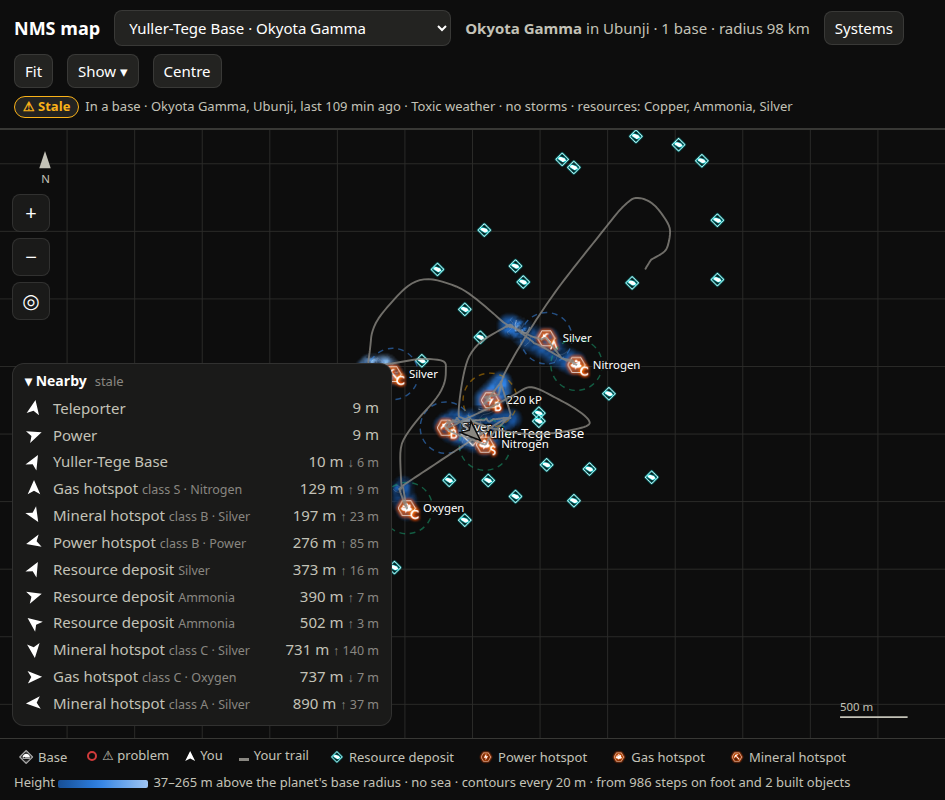
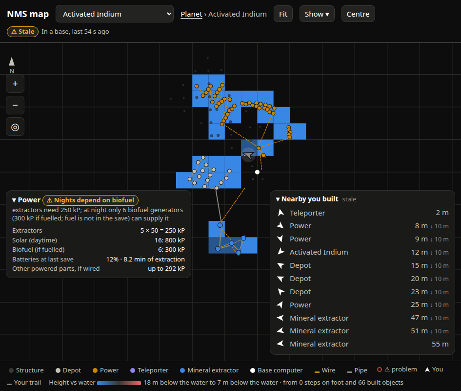

# SPEC-0062: Map heights: ground elevation from the trail, terrain raster, hillshade and contours

## Summary

The save has no terrain. But every live sample taken on foot or in an exocraft is a point on the
ground with a known height above the planet's nominal radius, and so is every ground-standing
base part. The map bins those into cells (lowest per cell), interpolates them into a
hill-shaded terrain surface with contour lines, and draws only near where the player has
actually been, fading out at the edge: unexplored ground stays dark. On a planet with a sea,
heights are measured from the water surface and coloured on a diverging ramp around it.

## Inputs and outputs

- Trail samples in the history store: `rel`, `distance_from_planet`, `location`, `sealevel`.
- Ground-standing base objects from the save.
- Serves `GET /api/elevation?address=<hex>&cell=<m>[&base=<name>]`
  ([docs/map-api.md](../../docs/map-api.md)).

## Requirements

### SPEC-0062-REQ-001: Ground samples

The system shall take a trail sample as a ground height only when `location` is `PlanetOnFoot`
or `PlanetInVehicle` (not indoors, caves, swimming or ships). It shall also use the world
position of every base object whose kind is `extractor-mineral`, `extractor-gas`, `depot`,
`power`, `computer` or `teleporter` (they stand on the ground).

### SPEC-0062-REQ-002: Nominal radius

`distance_from_planet` is height above the planet's nominal radius, so `|rel| - dfp` is the
radius; observed values are round multiples of 1024 (130048, 98304). For every sample with
`dfp < 20000` the system shall count `round(|rel| - dfp)` and take the **most common** value as
the planet's nominal radius (818 of 1002 samples agreed on one planet; ship and underwater
samples were off by up to 24 m, so "latest" is wrong).

### SPEC-0062-REQ-003: Water surface

`sealevel` from the hook is the water surface above the nominal radius (observed 120 on a water
planet, 0 on every dry one). The system shall record a planet's water level when a sample carries
a non-zero `sealevel`, and treat a planet with none as having no sea.

### SPEC-0062-REQ-004: Binning

For each ground point `w`, the system shall project it (planet projection, or `base_en` when
`base` is given), bin into square cells of `cell` metres (`floor(x/cell), floor(y/cell)`), and
keep the **lowest** height per cell (`|w| - radius`), so jetpack jumps do not raise the ground.
Heights shall then be reported relative to the water surface where there is one, else to the
nominal radius. `cell` defaults to 25 and is clamped to 2–500; the page asks for **25 m** in
planet view and **10 m** in base view. The result shall be cached until the inputs change.

### SPEC-0062-REQ-005: Interpolation

The page shall build a raster at half the cell size (`res = cell/2`) covering the sampled cells
plus a 4-cell margin. Each pixel's height is inverse-distance weighted over sampled cell centres
within ±4 cells and within `R = 3.5 × cell`, weight `1 / max(d², 1)`. Each pixel's alpha is 1
when the nearest sample is within `near = 1.2 × cell`, falling linearly to 0 at `R`; pixels with
no sample in reach are unknown. Row 0 is the north edge.

### SPEC-0062-REQ-006: Colour

- **No sea (sequential):** a nine-stop single-hue blue ramp `--seq-1`…`--seq-9` (the palette's
  steps 600 to 200), linearly from the observed `min` to `max`. The darkest steps are left out on
  purpose: an empty area means "never sampled", so the lowest sampled ground must still clear the
  background.
- **Sea (diverging):** `--div-below` (blue) ← `--div-mid` (gray) → `--div-above` (red), with
  `top = max(|min|, |max|, 2)`, `t = min(1, |h|/top)` and colour `mid + (end − mid) × √t`. Height
  0 is the water line and sits at the neutral midpoint.

### SPEC-0062-REQ-007: Hillshade

Each pixel's colour shall be multiplied by `lit = 0.45 + 0.75 × shade`, with the surface slope
exaggerated ×3, light from the north-west 45° up (`sun = (-0.5, 0.5, 0.7071)` in east, north, up)
and `shade = max(0, (-dzdx·sun.e - dzdy·sun.n + sun.up) / |(dzdx, dzdy, 1)|)`. Pixel alpha is
`235 × alpha`. The raster shall be upsampled 3× with high-quality smoothing and a 2 px blur so it
reads as ground, not tiles, then placed in the SVG world as one image in map units.

### SPEC-0062-REQ-008: Contours

When `max - min >= 4 m`, the page shall draw contours by marching squares over the raster at a
step chosen as the first of `1, 2, 5, 10, 20, 25, 50, 100, 200` m giving at most 12 levels
(else 500), skipping squares with any unknown corner or any corner alpha below 0.5. Every fifth
level (by `level / step mod 5 == 0`) is an index contour: `--ink-1` at 38 % opacity and 1.3 px;
the rest at 18 % and 0.8 px.

### SPEC-0062-REQ-009: Hover readout

With a mouse, while not in facing-up mode and not over a mark's hit target, the tooltip shall
show the interpolated height under the pointer: `<n> m above the planet's base radius (no sea)`,
or on a water planet `<n> m below|above the water` / `at the water surface` (within 1.5 m). It
shall show nothing where alpha is below 0.3.

### SPEC-0062-REQ-010: Legend states the scale (truncated-axis rule)

Because the ramp is stretched to the observed range (a truncated axis), the legend shall always
state the range and its reference, never a bare gradient:
`Height [gradient] 37–265 m above the planet's base radius · no sea · contours every 20 m · from
<n> steps on foot and <m> built objects`, or on a water planet
`Height vs water [gradient] <min text> to <max text> …`. No area fill outside sampled ground
shall imply a zero.

### SPEC-0062-REQ-011: Refresh and toggle

Heights shall reload every 15 s and when the planet or base changes, discarding a response for a
view no longer shown. "Heights" in the Show menu hides the layer and its legend entry.

### SPEC-0062-REQ-012: Cell geometry and units

Cell `(i, j)` from the API covers `[i·cell, (i+1)·cell) × [j·cell, (j+1)·cell)` in the current
view's map metres (planet projection `x, y`, or base `e, n`), and its height is in metres. The
page shall place the raster in the SVG world in the same units, so heights line up with marks,
trail and footprints at every zoom and rotate with the world in facing-up mode.

### SPEC-0062-REQ-013: Source of the reference

The legend and hover text shall name the reference they use: "above the planet's base radius
(no sea)" on a dry planet, "below/above the water" on a planet with a sea. The response carries
`radius`, `water`, `samples` (ground samples used) and `objects` (built objects used) so the
legend can say what the surface is built from.

## Degraded behaviour

- **Planet never visited with the hook:** `/api/elevation` returns
  `{error: "not known until you visit this planet with the live_position mod running", cells: []}`;
  the legend says `Heights: <error>`. No guess at sea level.
- **Visited but nothing sampled:** legend `Heights: none yet. Walk around on foot to collect them`.
- **Base given without a layout:** `{error: "no layout for <base>", cells: []}`.
- **Store down:** 503; the layer stays empty and the database banner shows.
- **Fewer than 4 m of relief:** surface drawn, no contours.

## Verification

- Walk a loop up a hill: the sampled strip appears, brighter uphill, shaded on the south-east
  slopes, contours crossing the slope.
- On a water planet a shoreline walk shows a gray band at 0 with blue below and red above, and
  the hover reads `at the water surface` on the beach.
- Jetpack repeatedly in one spot: that cell's height does not rise.
- Compare the legend's `min–max` with `/api/elevation`'s `min`/`max`.

## Lessons

See [SPEC-0079](../lessons/SPEC-0079-map-ui-lessons.md): most-common nominal radius; the lowest
sequential steps vanish against the page.
