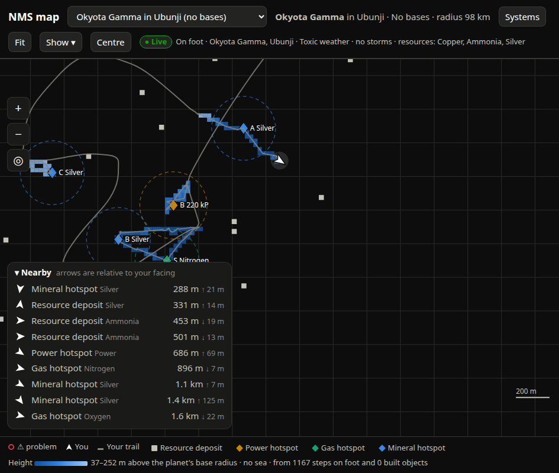
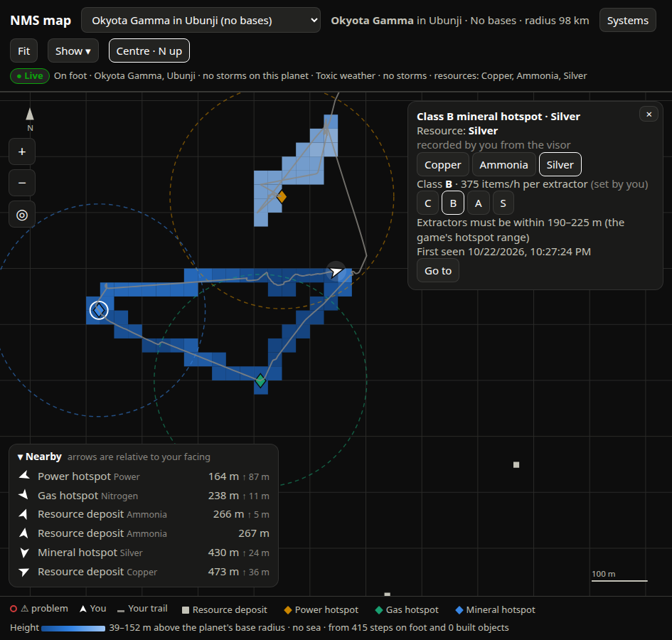
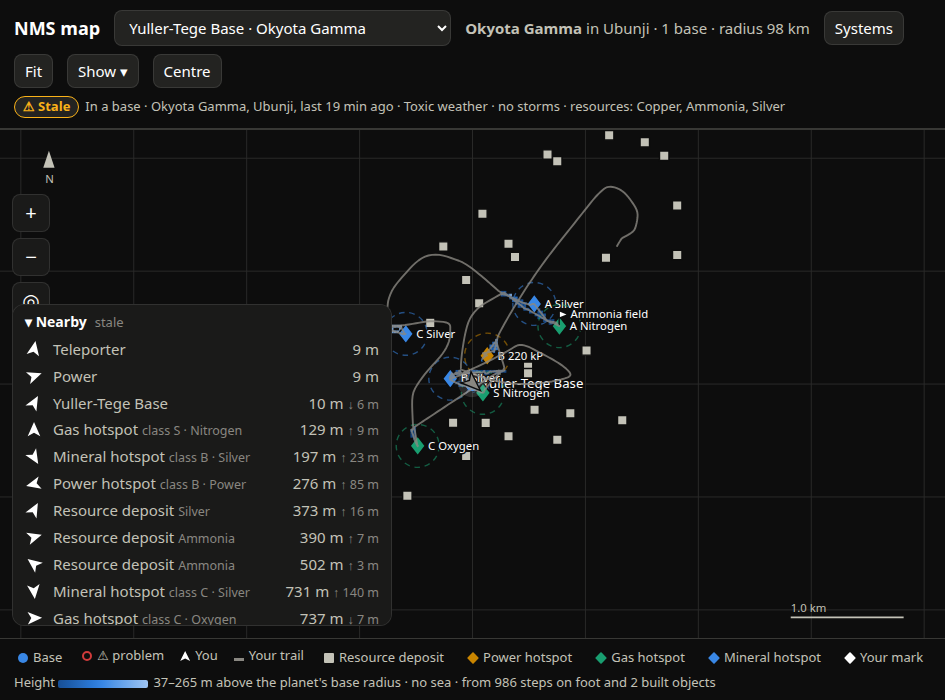

# SPEC-0063: Map finds: hotspots, deposits and marks, with player-recorded class and resource

## Summary

The live hook logs every marker the game adds (live-hook area): `MineralHotspot`, `GasHotspot`,
`PowerHotspot` when the player reaches a surveyed hotspot, and `TerrainResource` ("Cobalt
Deposit") markers as an area loads. The finds layer places these on the planet, names what they
give where the game data allows, and lets the player record what the marker does not carry
(class C/B/A/S, and which of several resources a mineral hotspot gives) from the map or from an
in-game chat command. Finds are drawn with the game's own HUD icons, with the extractor reach
around each hotspot.

## Inputs and outputs

- History store: visor rows (`event: marker_add` with `type`, `name`, `rel`, `t`, optional
  `raw`), chat `label` rows (`class`, `resource`, `rel`, `t`) and `mark` rows (`name`, `rel`, `t`);
  stored labels (`find_label` table: key → {class, resource, t}); planet facts (`substances`,
  `biome`, …).
- Game tables: item names, extraction table (`biome_gases`, `items_per_hour_by_class`, hotspot
  `range_m` and power `class_strength`), from game-data.
- Game HUD icons served at `/icon/<name>.png` from files the user extracts locally from their own
  installed game (game-data area). They are never in the repository.
- Serves `GET /api/finds?address=<hex>[&base=<name>]` and `POST /api/finds/class`.

## Requirements

### SPEC-0063-REQ-001: Placing a marker on a planet

A marker row has no address. The system shall place it on the planet the trail says the player
was on at the row's time `t`: the last `(t_i, address)` in the trail's planet-change timeline
with `t_i <= t`. Rows earlier than the timeline shall be held and retried on the next refresh.
The marker's `rel` (marker local + offset − nearest planet centre) is in the planet frame.

### SPEC-0063-REQ-002: Kinds and merging

Types map to kinds: `MineralHotspot` → `hotspot-mineral`, `GasHotspot` → `hotspot-gas`,
`PowerHotspot` → `hotspot-power`, `TerrainResource` → `deposit`; `/mark` rows → `mark`. Markers
of the same kind on the same planet whose positions round to the same **5 m** grid
(`round(c / 5)` per axis) are one find, keeping the first and last times. The find key is
`"<ADDRESS hex>:<kind>:<rx>:<ry>:<rz>"` with `r* = round(c / 5)`.

### SPEC-0063-REQ-003: Resource

- `mark`: its name, basis "your mark (/mark)".
- `deposit`: its name minus ` Deposit`.
- `hotspot-power`: `Power`.
- `hotspot-gas`: from the planet's biome in the extraction table: Gas1 by biome, Gas2 always
  Oxygen; if they differ, `options: [g1, g2]` and resource `"g1 or g2"`; unknown biome →
  `null`, basis "planet biome not known yet".
- `hotspot-mineral`: any of the planet's three substances (seen: the common one on one planet,
  the rare one on another), so `options` = the three, resource `"A or B or C"`, basis "one of the
  planet's three resources; the visor says which".
- A recorded resource replaces this, basis "recorded by you from the visor".

### SPEC-0063-REQ-004: Recording class and resource on the map

A hotspot's details panel shall show `C B A S` buttons and, when there are options, one button
per option; the current choice is outlined. Tapping posts
`POST /api/finds/class {key, class|resource: value}`; tapping the current choice posts `null`
and clears it. The server shall accept class only in `C, B, A, S, null`, reject unknown keys
(400), store with a timestamp, and the page shall reload finds and reopen the panel. The panel
shall show the output for the chosen class (`items/h per extractor` or `kP` for power) or all
four (`C/B/A/S give 250/375/…`) until set, and `Extractors (or Electromagnetic generators) must be
within <lo>–<hi> m (the game's hotspot range)`.

### SPEC-0063-REQ-005: Chat labels

An in-game chat `/hs S silver` logs a `label` at the player's position. The system shall apply it
to the nearest hotspot on that planet within **50 m** (`CHAT_LABEL_M`); the resource word is
matched by prefix against that hotspot's options (`nit` → Nitrogen), else title-cased. Chat
labels shall stay in the log and never be copied into stored labels; **per field, the newer of
chat and map wins**, so a correction on the map is not undone by replaying an older chat label.
Labels matching no hotspot are returned as `unmatched_labels`.

### SPEC-0063-REQ-006: Marks

`/mark <name>` adds a named point. With icons it shall be drawn as the game's custom-marker icon
(26 px) with its name; without, as a flag on a pole. Marks are never grouped and their labels
have the highest declutter priority (5).

### SPEC-0063-REQ-007: Drawing a find

- Hotspots: icon `surveying.<minerals|gas|power><class letter lower-case or none>` at 30 px (the
  icon carries the class letter like the visor); fallback a diamond 8 px half-width in the kind
  colour. Around it a dashed (6/5 px) 1.5 px reach ring of radius `ranges[kind][0]` metres
  (fallback 190) at 55 % opacity.
- Deposits: icon `pickup.mineral` at 20 px; fallback a 10 px square. No ring.
- Beside a hotspot a label with priority 3: resource (or `?` while options are unresolved), or
  for power `<kP> kP` when the class is set else `power`; without icons prefixed by the class
  letter or `?`. Labels use `--ink-1` when a class is set, `--ink-2` otherwise.
- Every find gets an invisible 14 px-radius hit target (SPEC-0064-REQ-001) in the finds hit
  layer, opening its details; with a mouse a tooltip gives its title
  (`Class B mineral hotspot · Silver`, `Silver deposit`, `Your mark: <name>`).

### SPEC-0063-REQ-008: Grouping when zoomed out

The page shall group finds whose screen positions are within **26 px**: sort by priority
(hotspot with class 3, hotspot 2, deposit 1), and each find joins the first group whose seed is
within 26 px, else seeds a new group. A seed with members draws a count badge (8.5 px `--ink-1`
circle, count in `--page`, offset 11 px up-right) instead of its label; members draw only their
reach ring (35 % opacity). Tapping a group zooms to its members' bounding box × 4 (at least
40 m span) and stops following. Grouping is recomputed on every zoom.

### SPEC-0063-REQ-009: Hit layer order

The finds hit layer shall sit **above** the built objects' hit layer: extractors are built on
their hotspot, and the hotspot must stay tappable.

### SPEC-0063-REQ-010: Kind collision with drained deposits

The save's drained deposits use kind `deposit` (label "Drained deposit"); a visor deposit is a
different thing. The page shall map a find of kind `deposit` to the client kind
`deposit-find` ("Resource deposit") for its colour, icon, legend chip and toggle.

### SPEC-0063-REQ-011: In base view

When `base` is given, each find shall also carry `e, n, h` in the base frame and the base view
shall draw finds there.

### SPEC-0063-REQ-012: Nearby and Places

Finds shall appear in the Nearby list (SPEC-0061-REQ-015) labelled
`class <C> · <resource or name>` and in Places (SPEC-0067). `Go to` targets them as
`w:<x>,<y>,<z>`.

### SPEC-0063-REQ-013: Refresh and legend

Finds shall reload every 15 s and on planet/base change. Each find kind present gets a legend
chip (icon or shape) that toggles it (SPEC-0064-REQ-004).

## Degraded behaviour

- **No icons extracted:** a `HEAD /icon/base.png` at load fails; the page uses shapes everywhere
  (diamonds, squares, flags) and colour chips in the legend.
- **Planet facts unknown:** resources show `?` with the basis explaining why.
- **Store down:** `/api/finds` 503 → layer empty and the database banner; a class POST returns
  503 and the page shows the banner instead of failing silently.
- **Marker before any trail:** held until the trail covers its time.
- **Hotspot reach unknown:** ring of 190 m.

## Verification

- Survey and reach a hotspot in game: within 15 s it appears on the map in the right place
  relative to the live arrow.
- Set class B, reload: still B. Type `/hs S` in game within 50 m: becomes S (newer). Set A on the
  map: becomes A and stays A after an exporter restart.
- Zoom out until three hotspots overlap: one icon with a `3` badge; tap it: zoomed to them.
- Build an extractor on a hotspot: tapping the spot opens the hotspot, not the extractor.

## Lessons

See [SPEC-0079](../lessons/SPEC-0079-map-ui-lessons.md): the deposit kind collision and the hit
layer order. Decision: [SPEC-0072](../decisions/SPEC-0072-player-records-hotspot-class.md).
