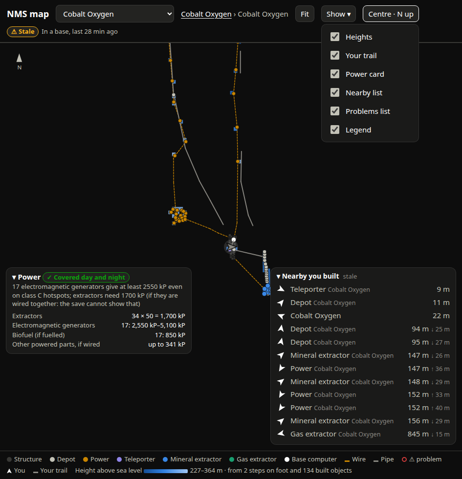

# SPEC-0064: Map interaction: tap targets, tooltip, selection, legend, Show menu, zoom, grid and declutter

## Summary

The map is used on a phone in one hand while the game is played on another screen, and on a
desktop with a mouse. Marks are drawn small so a dense base stays legible, but every mark has a
finger-sized invisible target above it. Labels that would collide give way to more important
ones. What is drawn can be trimmed per device. This spec covers those shared mechanics.

## Inputs and outputs

Browser only. Per-device state in `localStorage` (all access wrapped in try/catch; the page works
without it):

| key | value |
|---|---|
| `nms-map-show` | `{shapes, sectors, heights, trail, power, nearby, issues, legend: bool}` |
| `nms-map-hidden-kinds` | JSON array of hidden kinds and segment types |
| `nms-nearby-collapsed` | `"1"` / `"0"` |

## Requirements

### SPEC-0064-REQ-001: Tap targets

Every tappable mark shall have an invisible (transparent fill) circular hit target in a hit layer
drawn above all marks, of radius `max(mark radius + 6, 14)` screen pixels (≥ 28 px across), with
`cursor: pointer`. The visible mark stays its own size. Layer order inside the world group,
bottom to top: grid, heights, sectors, content (footprints, segments, dots, labels), finds,
selection ring, built-object hits, **finds hits**, live layer.

### SPEC-0064-REQ-002: Dots

Without an icon, a mark is a circle of radius 8 px (base), 5 px (extractor, computer), 2.5 px
(structure, 70 % opacity) or 4 px (other), filled with its kind colour and outlined 1 px in
`--page`. A mark with problems is 2 px larger with a 3 px `--critical` outline; with an icon it
gets an 18 px `--critical` ring. Icons: base 30 px, others 24 px. Kind colours:

| kind | label | token |
|---|---|---|
| base | Base | `--series-1` |
| exocraft | Exocraft | `--series-7` |
| deposit | Drained deposit | `--ink-muted` |
| settlement | Settlement | `--series-4` |
| extractor-mineral / -gas | Mineral / Gas extractor | `--series-1` / `--series-3` |
| depot | Depot | `--ink-2` |
| power | Power | `--series-4` |
| refiner | Refiner | `--series-2` |
| teleporter | Teleporter | `--series-7` |
| computer | Base computer | `--ink-1` |
| plants | Plants | `--series-3` |
| structure | Structure | `--axis` |
| hotspot-mineral / -gas / -power | … hotspot | `--series-1` / `-3` / `-4` |
| deposit-find | Resource deposit | `--ink-2` |
| mark | Your mark | `--ink-1` |

Segments: pipe `--ink-muted` solid; wire `--series-4` dashed; wire teleport (`link`)
`--series-7` dotted.

### SPEC-0064-REQ-003: Tooltip, selection and details

With a mouse (`pointerType === "mouse"` only), hovering a hit target shall show a tooltip 14 px
right of and 34 px above the pointer, clamped inside the map. Tapping a mark shall open the
details panel (top-right, ≤ 360 px, `×` to close) and draw a 13 px `--ink-1` selection ring at
the item. Details: for a base, name, object count, lat/lon, power verdict pill, portal glyphs,
`Open layout`, `Go to`; for a layout item, kind and ID, `<dist> <compass> (<bearing>°) of the
base computer, <±h> m height`, problems as critical pills with fill and pipe gap; for a planet
point, distance and compass from the map centre.

### SPEC-0064-REQ-004: Legend chips toggle kinds

The legend footer shall list each kind present (icon or colour swatch, label) as a button;
tapping it hides or shows that kind everywhere on the map (dots, footprints, finds, globe), shown
struck through and dimmed while off, and remembered per device. Segment types are chips too.
Fixed entries follow: `⚠ problem` (critical ring), `You` (arrow), `Your trail`, and the heights
scale (SPEC-0062-REQ-010). A mark with problems is drawn even if its kind is hidden. Toggling
keeps the current view.

### SPEC-0064-REQ-005: Show menu

`Show ▾` shall open a menu of checkboxes, all on by default and remembered per device:
Building shapes, Sectors and charted ground, Heights, Your trail, Power card, Nearby list,
Problems list, Legend. It closes on any pointer-down outside it.

### SPEC-0064-REQ-006: Pan and zoom

- Drag pans. Pointer capture shall be taken **only once the pointer has moved more than 4 px**;
  capturing on press steals the click from the mark under a tap.
- Wheel zooms about the cursor by `exp(deltaY × 0.0015)`.
- Two pointers pinch-zoom about their midpoint by the ratio of their distances.
- `+` / `−` buttons zoom by 1.6 about the uncovered centre; `◎` centres on the player once.
- The cursor is `grab`, `grabbing` while dragging.

### SPEC-0064-REQ-007: Grid and scale bar

The scale bar length shall be the largest of `1, 2, 5, 10 × 10^n` metres not exceeding 120 px,
drawn bottom-right (16 px in, 22 px up) in `--ink-2` with its distance (`<n> m`, `<n.n> km`,
`<n> km` at ≥ 10 km). A recessive `--grid` line grid at the same spacing shall cover a square of
half-side `hypot(view.w, view.h)` about the view centre so it still covers the view when rotated.
A north arrow sits top-left (SPEC-0061-REQ-010).

### SPEC-0064-REQ-008: Label declutter

Every anchored label shall carry a priority: marks and problems 5, bases 4, hotspots 3, default
2, sector names 1. After any redraw or zoom the page shall sort labels by priority (highest
first), measure each one's screen bounding box, and hide any label overlapping one already kept.
Screen-space boxes make it work rotated. Zooming in brings hidden labels back.

### SPEC-0064-REQ-009: Label legibility

Labels shall have a 3 px `--page` stroke under the fill (`paint-order: stroke`, round joins) so
they read over heights and lines. Base names that would sit within one label height (18 px) and
160 px of another base's label are stacked 18 px down.

### SPEC-0064-REQ-010: Constant on-screen size

On every zoom the page shall rescale every element that declares a pixel radius, stroke width,
dash, font size or icon size by the current metres-per-pixel, redraw the selection ring, finds
(grouping depends on zoom), live layer, rotation and declutter.

### SPEC-0064-REQ-011: Problems list and power card

A problems card in the dock shall list loose extractors (`⚠ loose` critical pill + text); tapping
a row zooms to 60 m around it (base view) or opens the base (planet view). The power card is
SPEC-0066.

### SPEC-0064-REQ-012: Resize

On window resize the page shall re-render after 150 ms of quiet.

## Degraded behaviour

- **Storage blocked:** defaults (everything shown, nothing hidden, Nearby open) every load.
- **No icons:** shapes and colour swatches.
- **Touch only:** no tooltips; the details panel carries the same text.

## Verification

- On a phone, tap a 2.5 px structure or a depot in a dense base: its details open first time.
- Drag starting on a mark: the map pans and the mark's panel does not open.
- Turn off "Depot" in the legend, reload: still off.
- Zoom out on a planet with many hotspots: lower-priority labels disappear before base names;
  zoom in: they return. Same with facing-up on.
- Scale bar reads a 1/2/5 value and matches the grid spacing.

## Lessons

See [SPEC-0079](../lessons/SPEC-0079-map-ui-lessons.md): pointer capture stealing taps;
declutter in screen space.
