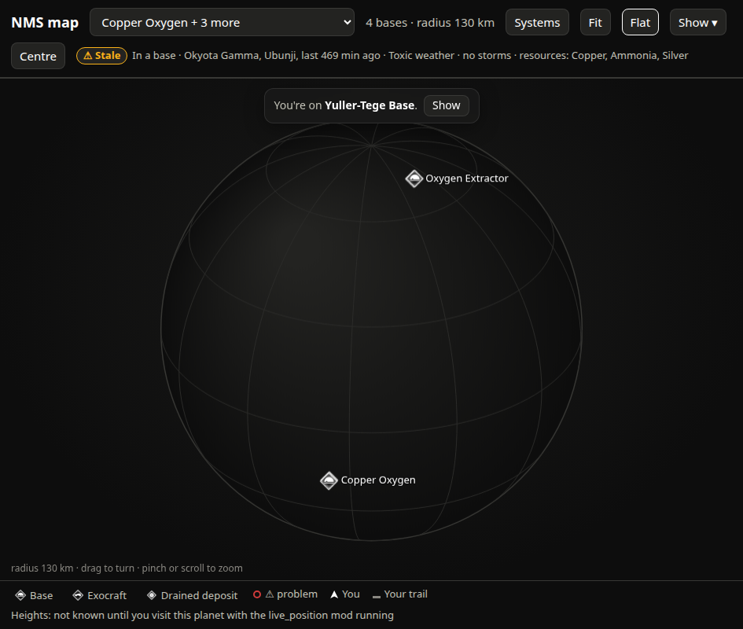

# SPEC-0065: Map globe: orthographic planet view on a canvas

## Summary

The flat planet view is true only from its centre. When bases are far apart (another continent,
the far side of the planet) the flat map stretches them. The Globe button swaps the SVG for a
canvas showing the planet as an orthographic globe with everything at its true position on the
sphere. It can be turned by dragging (the surface follows the finger), zoomed, and tapped.



## Inputs and outputs

Client only. Uses `/api/map` points' planet-frame positions `w`, finds' `w`, the live player's
`w`, `/api/sectors` geometry, and `tile_colours`.

## Requirements

### SPEC-0065-REQ-001: Projection

The globe shall be orthographic about a unit centre direction `gc`. With `north, east` the
tangent frame at `gc` (SPEC-0060-REQ-001), canvas centre `(cx, cy)` and radius `Rpx`:

```
screen(u) = ( cx + Rpx (u·east),  cy - Rpx (u·north),  depth = u·gc )
```

A point is on the visible hemisphere when `depth > 0`. `Rpx = 0.42 × min(width, height) × zoom`,
using the width left of the Places sheet when it is open on a screen wider than 760 px (sheet
width + 24 px), and the height above the dock (SPEC-0060-REQ-011). The canvas is drawn at
`devicePixelRatio`.

### SPEC-0065-REQ-002: Sphere and graticule

The sphere shall be filled with a radial gradient lit from the upper left (inner circle at
`(-0.35 R, -0.4 R)`, radius `0.1 R`) from `--surface-2` to `--page`; when tile colours are known
their average is mixed in (45 % at the light, 12 % at the edge). Outline 1.5 px `--axis`.
Graticule in `--grid`, 1 px: parallels at −60, −30, 0, 30, 60° and meridians every 30°, sampled
every 3°, front side only (a pen-up wherever depth ≤ 0).

### SPEC-0065-REQ-003: Initial orientation

On opening, `gc` shall be the player's position if they are on this planet, else the normalised
sum of the planet's base positions, else `[0, 0, 1]`; zoom 1. Opening the globe turns `Centre`
off.

### SPEC-0065-REQ-004: Marks and labels

The globe shall draw sectors (SPEC-0067-REQ-007), then every planet point and every visible find
whose `depth > 0.02`, bases last so they sit on top: the kind's game icon (base 26 px, deposit
16 px, others 22 px) or a 5 px dot in the kind colour. Labels (13 px, `--ink-1` with a 3 px
`--page` stroke) for named items are placed after all icons, ranked bases, then marks, then the
rest; a label whose box would overlap one already placed is skipped. The player, when on this
planet and on the visible side, is a 6 px dot (`--ink-1` live, `--ink-muted` stale). A footer
line reads `radius <r> · drag to turn · pinch or scroll to zoom`.

### SPEC-0065-REQ-005: Drag to turn (grab style)

Dragging shall turn the globe so the surface under the finger follows it on **both** axes:

```
gc = normalise( rotate( rotate(gc, north, -dx / Rpx), east, -dy / Rpx ) )
```

(`rotate(v, axis, θ)` by Rodrigues; `north, east` at the current `gc`). Swiping right brings what
was on the left into view; swiping down brings what was above into view.

### SPEC-0065-REQ-006: Zoom

Pinch shall scale zoom by the ratio of pointer distances; the wheel by `exp(-deltaY × 0.0015)`;
zoom is clamped to 0.6–8.

### SPEC-0065-REQ-007: Tap

A pointer-up after less than 6 px of movement is a tap: the nearest drawn item within 16 px
opens. A base closes the globe and opens its layout; a find opens its details; another point
opens its details.

### SPEC-0065-REQ-008: Globe button

The `Globe` button shall always be shown. In planet view it toggles the globe (label becomes
`Flat`). From a base layout it first returns to the planet view, then opens the globe. While the
globe is shown the SVG is hidden and the zoom controls are hidden; opening a base closes the
globe.

### SPEC-0065-REQ-009: Live redraw

The globe shall redraw on every live poll, finds/sectors reload, icon load and Places tap.

### SPEC-0065-REQ-010: Icon images

Icons on the globe shall be loaded once per name into an image cache and drawn only once loaded
(`complete` and non-zero natural width); each image's load event shall redraw the globe while it
is shown, so icons appear as they arrive rather than on the next poll.

### SPEC-0065-REQ-011: Canvas sizing

On every draw the canvas shall be sized to the map area times `devicePixelRatio` and the context
scaled by the same factor, so lines and text stay sharp on high-density phone screens and after
a resize or rotation of the device.

### SPEC-0065-REQ-012: Finds and hidden kinds

Finds shall be drawn on the globe only when their kind is not hidden in the legend
(SPEC-0064-REQ-004). Finds have no labels on the globe except marks (their name); base names
always win label space.

### SPEC-0065-REQ-013: Far side

Items with `depth ≤ 0.02` (on or just behind the limb) shall not be drawn or be tappable, so a
mark on the far side cannot steal a tap from one in front.

## Degraded behaviour

- **No icons:** dots in the kind colour.
- **No tile colours:** neutral sphere.
- **No sectors:** sphere, graticule and marks only.
- **Player not on this planet:** no player dot; centre on the bases.

## Verification

- Two bases on opposite hemispheres: on the globe each appears in turn as you drag; their
  great-circle separation (shown in Places when standing at one) matches `R × angle`.
- Put your finger on a base and drag it to the top of the screen: it stays under the finger.
- Pinch: the globe grows to at most 8× and shrinks to 0.6×.
- From a base layout press Globe: the planet's globe opens.


## Lessons

See [SPEC-0079](../lessons/SPEC-0079-map-ui-lessons.md): the drag direction took two attempts;
the Globe button must not vanish in base view. Decision:
[SPEC-0071](../decisions/SPEC-0071-svg-world-canvas-globe-no-libraries.md).
