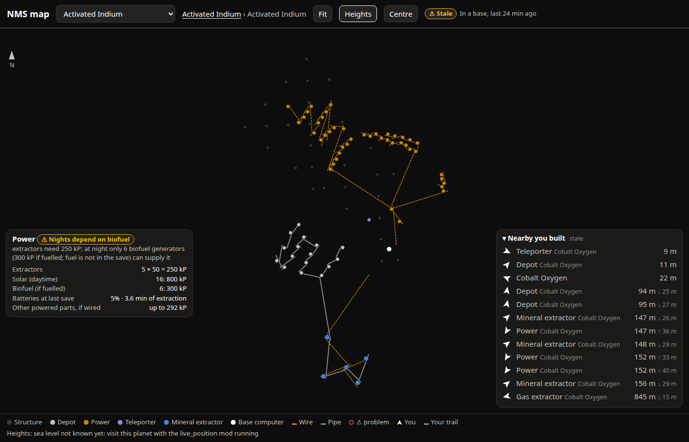
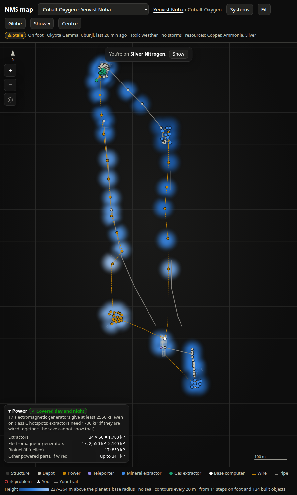

# SPEC-0066: Map base view: building footprints, segments and the power card

## Summary

A base layout is hundreds of parts. As dots it is a cloud; drawn at true size it reads like the
base itself: floors tile, walls line rooms, extractors and generators sit at their real size.
The game's placement collision boxes for every part (extracted by the game-data area into
`part_footprints.json`) give each object a ground rectangle. The base view also shows a power
card: whether the base's extractors are covered at night, from what the save can and cannot
prove.


## Inputs and outputs

- `part_footprints.json`: `{"footprints": {"<ObjectID without ^>": [minx, miny, minz, maxx,
  maxy, maxz]}}` in the part's own frame (x right, y up, z = its At). Path configurable by
  environment variable; reloaded when its mtime changes. From game-data (SPEC-0020–0039).
- Save objects: `Position`, `Up`, `At`, `ObjectID`, `UserData`.
- Game base-building table: per-part power `rate_per_s`, `network`, `dependencies`, battery
  `storage`; extraction table power hotspot `class_strength`.
- Output inside `/api/map` → `layouts[<base>]`: `items[].poly`, `items[].top`, `footprints`,
  `power`.

## Requirements

### SPEC-0066-REQ-001: Footprint polygon

For an object with a box, the system shall compute in the base-local frame:

```
up = normalise(o.Up or [0,1,0]);  f = normalise(At - (At·up) up);  r = up × f
corners = [ base_en(P + r·x + f·z)[:2]  for (x,z) in (x0,z0),(x1,z0),(x1,z1),(x0,z1) ]
top     = base_en(P + up·y1).height
```

and return `poly` (four `[e, n]`) and `top` (metres above the base computer). Adjacent floor
tiles shall share exact corners.

### SPEC-0066-REQ-002: Draw order and style

Where "Building shapes" is on and any item has a polygon, the base view shall draw polygons
sorted by `top`, lowest first, so upper floors and roofs overlay what is under them and stacked
storeys build up the fill. Structures: `--ink-2` fill at 13 %, stroke 40 %, 0.6 px. Every other
kind: its kind colour, fill 32 %, stroke 85 %, 1 px. Round joins. Hidden kinds are skipped.

### SPEC-0066-REQ-003: Structures are polygons, utilities are polygons plus dots

A structure with a polygon shall not get a dot; its polygon is tappable (opens details) and with a
mouse shows `<id lower-cased, underscores as spaces> · top +<n> m`. Every non-structure item
keeps its dot (or icon) on top of its polygon, in the order structure, plants, depot, power,
refiner, teleporter, mineral extractor, gas extractor, computer, with problems last. Each dot's
tooltip: `<kind label> · <dist> <compass> of the computer` (omitted within 2 m).

### SPEC-0066-REQ-004: Segments

Pipes, wires and wire teleports shall be drawn as lines from `a` to `b` in `base_en`, under the
dots, styled per SPEC-0064-REQ-002, round caps. Loose extractors get a `⚠ <problems>` label in
`--critical` (priority 5).

### SPEC-0066-REQ-005: Fit

The base view shall fit all items with 6 % padding.

### SPEC-0066-REQ-006: Power budget

For a base with any extractor, generator, solar panel, biofuel generator or battery the system
shall compute:

- `demand` = extractors × 50 kP (from the table's Power dependency, default 50);
- electromagnetic generators `em` give `em × rate × class strength`, so a range
  `[em × 150, em × 300]` kP across classes C–S (C 150, B 220, A 250, S 300; table overrides);
- biofuel `bio × 50` kP, only if fuelled (fuel is not in the save);
- solar `sol × 50` kP, daytime only;
- battery charge = Σ `UserData >> 32` over batteries, capacity `n × 45000`, `charge_pct`, and
  `battery_minutes = charge / demand / 60`;
- other powered parts' draw as "up to" (they draw only when wired).

### SPEC-0066-REQ-007: Verdicts

| condition | status | headline |
|---|---|---|
| no extractors | none | No extractors |
| `em_lo ≥ demand` | good | Covered day and night |
| `em_hi ≥ demand` | warning | Needs class `<lowest class that covers>` or better power hotspots |
| `em_hi + bio ≥ demand` | warning | Nights depend on biofuel |
| otherwise | critical | Short `<demand − em_hi − bio>` kP at night |

Each carries a `why` sentence that names what the save cannot show (hotspot class, fuel, which
parts the wires join), and for critical whether solar covers the day.

### SPEC-0066-REQ-008: Power card

In base view, where the Power card is shown and the status is not `none`, the dock shall show
`▾ Power <pill>` with the pill as glyph + headline in the status hue (`✓` good, `⚠` warning,
`✕` critical), then the `why`, then a table: Extractors `n × 50 = X kP`, Electromagnetic
generators `n: lo–hi kP`, Solar (daytime), Biofuel (if fuelled), Batteries at last save
`<pct>% · <min> min of extraction`, Other powered parts, if wired `up to X kP`. Tapping the title
collapses it to the one-line verdict; it starts collapsed at widths ≤ 700 px. The same pill
appears in a base's details on the planet view.



### SPEC-0066-REQ-009: Problems on the layout

Items flagged by the extractor check (save-exporter area, SPEC-0005) shall be drawn on top of
their kind's dots with the problem ring (SPEC-0064-REQ-002), labelled, and listed in the
Problems card; their details show fill (`<n>/250`), the gap to the nearest pipe end, and the
nearest network when known. The planet view's base label reads `<name>  ⚠ <n> loose` in
`--critical` when any of its extractors are flagged.

## Degraded behaviour

- **No footprint file:** `footprints: false`, no `poly`; the base view is dots only and the
  Building shapes toggle has no effect.
- **Part missing from the file:** that part is a dot.
- **Object without `Up`/`At`:** no polygon.
- **No tables:** power uses the defaults above.

## Verification

- A floor of tiles shows as a seamless grid with shared edges (zoom to a corner: one vertex).
- A two-storey room shows darker where storeys overlap; hovering a roof shows its top height.
- An extractor's square is its true footprint, centred on its dot.
- A base with 6 electromagnetic generators and 7 extractors reads "Covered day and night"
  (6 × 150 = 900 ≥ 350). With 2 generators and 7 extractors it reads "Needs class B or better
  power hotspots" (2 × 150 = 300 < 350 ≤ 2 × 220 = 440).



## Lessons

See [SPEC-0079](../lessons/SPEC-0079-map-ui-lessons.md). Footprint extraction lessons live in the
game-data area.
