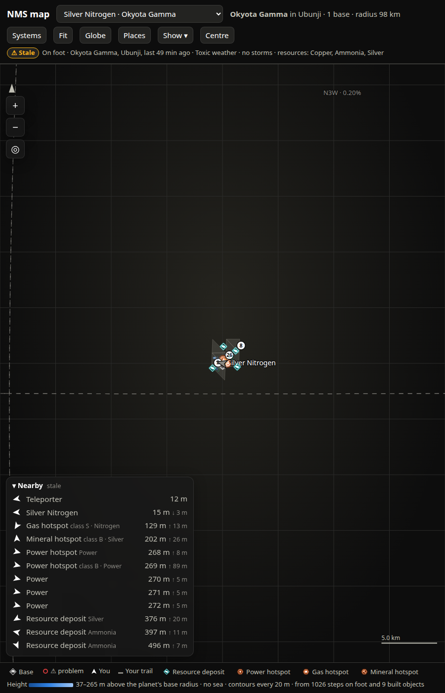

# SPEC-0067: Map sectors and the Places sheet

## Summary

Players asked for a planet map that fills in as you explore. Sectors give a planet a fixed,
nameable grid: 8 octants of the sphere, each split into 4, so "N3W" means the same patch of every
planet. Each sector is split further into cells about 1 km across; a cell counts as charted once
the trail has been in it near the ground. The Places sheet lists everything known on the planet,
sortable and filterable, with a `Go` that sets the map's waypoint, and a Sectors tab showing how
much of each sector is charted.



## Inputs and outputs

- Trail samples with `rel` and `distance_from_planet`; the planet's nominal radius
  (SPEC-0062-REQ-002).
- Bases and finds per planet, to count per sector.
- Serves `GET /api/sectors?address=<hex>` ([docs/map-api.md](../../docs/map-api.md)).

## Requirements

### SPEC-0067-REQ-001: Octants

The planet frame (north = +Y, longitude `atan2(x, z)` with east positive) shall be split by the
signs of x, y, z into 8 octants, numbered 0–7 as N1–N4, S1–S4. Quadrant `q` by longitude:
1 = 0–90°E, 2 = 90–180°E, 3 = 90–180°W, 4 = 0–90°W. Each octant is the spherical triangle
(pole, west corner, east corner):

```
pole = (0, +1, 0) for N, (0, -1, 0) for S
eq   = [(0,0,1), (1,0,0), (0,0,-1), (-1,0,0)]     # lon 0, 90E, 180, 90W
octant(i) = (pole, eq[i % 4], eq[(i % 4 + 1) % 4])
```

### SPEC-0067-REQ-002: Splitting and naming

A triangle `(a, b, c)` splits by its edge midpoints (normalised to the sphere) into four children
in this order: `(a, ab, ca)`, `(ab, b, bc)`, `(ca, bc, c)`, `(ab, bc, ca)`, i.e. corner a, corner
b, corner c, middle. A **cell path** is the octant digit followed by one digit 0–3 per split.
The first split names the sector:

```
sector_id(path)   = ("N" if o < 4 else "S") + str(o % 4 + 1) + "PWEC"[part]
sector_name(path) = same prefix + " " + ["polar", "west", "east", "centre"][part]
```

giving 32 sectors `N1P … S4C`.

### SPEC-0067-REQ-003: Locating a point

`locate(rel, depth)` shall pick the octant from the signs/longitude, then at each split descend
into the child for which the point's smallest signed margin to an edge
(`min(s·det(t0,t1,u), s·det(t1,t2,u), s·det(t2,t0,u))`, `s` the triangle's orientation sign) is
largest. Fine paths are stored at depth **8** (65,536 cells per sector).

### SPEC-0067-REQ-004: Charting

A trail sample with `distance_from_planet < 2000 m` (on foot, in an exocraft, or flying low) shall
mark its fine cell charted, keeping first and last times. Samples higher than that do not chart
the ground.

### SPEC-0067-REQ-005: Display depth

Cells shall be grouped to a display depth so a cell is about **1000 m** across:

```
edge  = radius × π / 4                       # a sector's edge, roughly
depth = clamp(round(log2(max(edge / 1000, 1))), 1, 7)
cells_per_sector = 4^depth
cell_km = radius × π / 4 / 2^depth / 1000
```

On a 98,304 m planet this gives depth 6, 4096 cells per sector, 131,072 in all, 1.21 km cells.
Area of `n` cells ≈ `n × cell_km² × √3 / 4` km².

### SPEC-0067-REQ-006: Sector summary

`/api/sectors` shall return each of the 32 sectors with `id`, `name`, `path`, `quadrant`,
`corners`, `centre`, `charted` (cells), `pct` (100 × charted / cells_per_sector), first/last
times, base names in it, and a count of finds in it; `you` (the player's sector if on this
planet); totals; and charted cells with corners. With the planet's projection it shall add
`cells[].xy` (projected corners), `sectors[].edge_xy` (each edge sampled at 17 points along the
great circle, `null` where the point is on the far hemisphere from the projection centre) and
`centre_xy` (null on the far side).

### SPEC-0067-REQ-007: Drawing sectors

Where "Sectors and charted ground" is shown, in planet view only: charted cells as polygons in
`--ink-2` (fill 16 %, stroke 35 %, 0.6 px); sector edges as dashed (3/3 px) 1.2 px `--ink-muted`
lines at 70 % opacity, broken at `null`s; and at each visible centre a label (priority 1)
`<id>` plus ` · you` and ` · <pct>` when charted. On the globe: cells fill at 35 % (a 2 px dot
when a cell is under 3 px), edges dashed 4/4 sampled at 25 points, labels at centres with depth ≥
0.25, the player's sector in `--ink-1`, others `--ink-muted`.

### SPEC-0067-REQ-008: Percent format

`0%`; `<0.01%` below 0.01; two decimals below 1; one decimal above.

### SPEC-0067-REQ-009: Places sheet

`Places` shall toggle a sheet on the right (≤ 400 px, glass) with tabs Places / Sectors and `×`.
The Places list shall hold every planet point with a position (bases, exocraft, settlements,
drained deposits) and every find, each with icon, title, subtitle (`<kind label>[ · class not
set] · <sector>`), distance and compass, and `Go`.


### SPEC-0067-REQ-010: Distance in Places

When the player is on this planet, distance shall be along the sphere from the player:
`acos(clamp(û·p̂)) × planet radius`, bearing from the player's tangent frame; the sort label reads
`Nearest you`. Otherwise distance and bearing from the flat map's centre, labelled
`Nearest the map centre`.

### SPEC-0067-REQ-011: Sort and filter

Sort options: distance; type (kind label, then distance); class (S, A, B, C, then unset; then
distance); name; sector (then distance). Filters: type (kinds present) and sector (only when more
than one sector is present). A count reads `<shown> of <total>`. Empty: "Nothing recorded on this
planet yet."

### SPEC-0067-REQ-012: Tapping a place

`Go` shall set the map's go-to target (SPEC-0061-REQ-016) and mark the row. Tapping elsewhere on
a row shall, on the globe, turn the globe to it; on the flat map, leave any base view (turning
Centre off) and zoom to 600 m around it; and open its details.

### SPEC-0067-REQ-013: Live refresh

While the Places tab is open, the list shall refresh with the live poll at most every 2 s, and
not while one of its controls has focus (a re-render would close an open select).

### SPEC-0067-REQ-014: Sectors tab

The Sectors tab shall show: `Charted <area> · <pct> of the planet`, an explanation (`<n> of <N>
cells about <k> km across, from your trail since live tracking began. A cell counts once you've
been in it on foot, in an exocraft or flying below 2 km.`), `You're in <id>`; then per octant
with any activity (charted, bases, finds, or you) a heading `North|South <q> <quadrant>` and a
row per active sector: id, part name, bases and finds, a bar **relative to the most-charted
sector** (minimum 3 % when non-zero), area and percent. Then `Not charted yet <n> of 32` as a
4-column grid of all 32 ids, inactive ones as buttons. Tapping any sector opens the globe if
needed, turns it to the sector's centre and zooms to at least 1.6.

### SPEC-0067-REQ-015: Refresh

Sectors shall reload every 20 s while the player is on this planet, else every 120 s.

## Degraded behaviour

- **Planet never visited live:** `{error: "not known until you visit this planet with the
  live_position mod running", sectors: [], cells: []}`; no sector layer; the tab shows the error.
- **Store down:** 503, database banner; Places still lists save points (no finds, no sectors).
- **Player elsewhere:** distances from the map centre; no `you`.

## Verification

- Stand at the north pole: `you` is an `N?P` sector. Cross the prime meridian eastward: N4 → N1.
- A 98 km planet reports 131,072 cells of 1.21 km.
- Walk 2 km in a straight line on foot: two or three new cells; fly at 3 km: none.
- With a base on the far side of the planet, Places shows its distance as `R × angle` (up to
  `π R`, about 300–400 km on a 100–130 km planet), not the flat-map distance.
- Tap `S2C` in the uncharted grid: the globe turns to it.

## Lessons

See [SPEC-0079](../lessons/SPEC-0079-map-ui-lessons.md): drained deposits needed positions to be
listable; selects closed under the 0.5 s poll.
