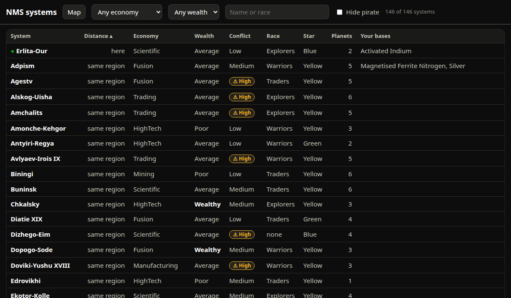
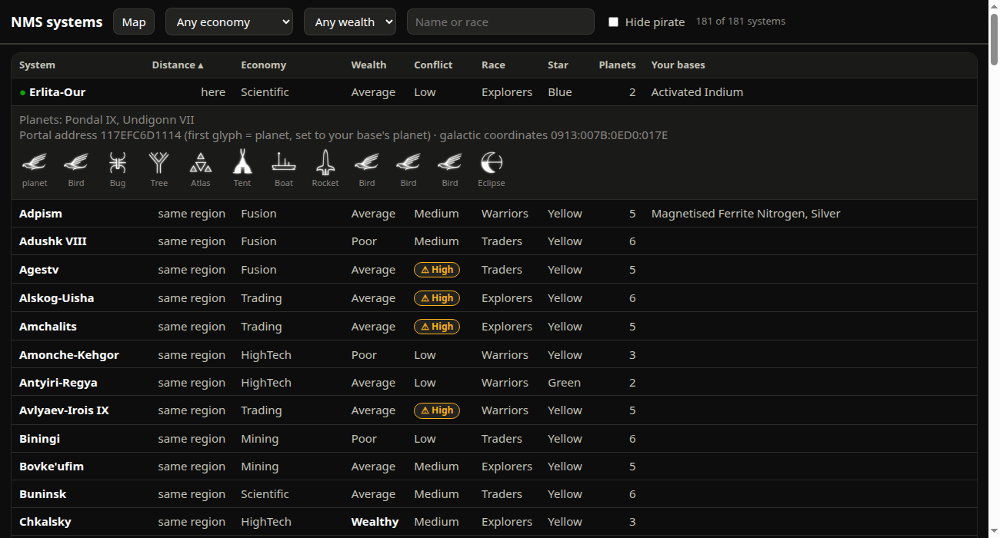

# SPEC-0068: Systems page: every star system seen, with portal addresses

## Summary

The live hook logs every star system the player hovers or visits on the galaxy map (economy,
wealth, conflict, dominant race, star class, planet count and planet seeds, flags) and the names
the game generates for systems and planets (live-hook area). `/systems` lists them as a sortable,
filterable table: how far, what kind of system, whether you have a base there, and the 12-glyph
portal address to dial it, with the glyphs the player has not learned yet dimmed. The page links
to and from `/map`, which also uses these names for planets.



## Inputs and outputs

- History store: `system` events keyed by universe address (planet bits clear), `system_name`
  (seed = system address), `planet_name` (seed = one of the system's `planet_seeds`).
- Save: bases (for "your bases" and portal planet), `KnownPortalRunes` bitmask.
- Glyph images at `/glyph/<0-f>.png`, extracted locally from the user's installed game
  (game-data area); never in the repository.
- Serves `GET /systems` (HTML) and `GET /api/systems?from=<address hex>`
  ([docs/map-api.md](../../docs/map-api.md)).

## Requirements

### SPEC-0068-REQ-001: System key and names

A system shall be keyed by its universe address with the planet bits (`0xF << 52`) cleared. A
system's name has that address as its seed; planet `n` (1-based, from the address's planet bits)
is named by `planet_seeds[n - 1]` (seen once in game; treat as a convention). Planet bits 0 are
never a planet.

### SPEC-0068-REQ-002: Voxel and distance

```
X = signed12(addr & 0xFFF), Z = signed12((addr >> 12) & 0xFFF), Y = signed8((addr >> 24) & 0xFF)
distance_ly = round( |voxel_a - voxel_b| × 400 )
```

400 ly per voxel is the community rule, not game data; systems in the same voxel show as `same
region`. `from` is any address in the player's current system (the page takes it from
`/api/live`).

### SPEC-0068-REQ-003: Galactic coordinates

`XXXX:YYYY:ZZZZ:SSSS` = `X + 0x7FF`, `Y + 0x7F`, `Z + 0x7FF`, system index, each 4 hex digits.

### SPEC-0068-REQ-004: Columns

System (bold; `● ` in `--good` before the one you are in; unnamed systems muted, "unnamed",
tooltip "Hover it on the galaxy map to get its name"; anomaly as a note), Distance (`here`, `same
region`, `≈ <n> ly`, `–`), Portal address, Economy, Wealth (`Wealthy` in bold `--ink-1`), Conflict
(`☠ Pirate` serious pill, `⚠ High` warning pill, `Default` shown as `Medium`, else plain), Race
(`None_` as `none`), Star, Planets, Your bases.

### SPEC-0068-REQ-005: Default sort

Your system first; then named systems before unnamed; then by the chosen key (default distance
ascending); ties by name. Wealth and conflict sort by their game order (Poor, Average, Wealthy,
Pirate / Low, Default, High, Pirate); Your bases by count. Clicking a header sorts by it; clicking
again reverses (▴ / ▾).

### SPEC-0068-REQ-006: Portal address

The 12-glyph code shall be the universe address without its reality byte, as hex digits:

```
portal = f"{P:X}{system:03X}{Y:02X}{Z:03X}{X:03X}"
         P = planet (1-15), system = (a>>40)&0xFFF, Y = (a>>24)&0xFF, Z = (a>>12)&0xFFF, X = a&0xFFF
```

`P` is the planet of one of your bases in that system if any, else 1 (planet 0 becomes 1: a
portal lands on a planet). When `KnownPortalRunes` is known and `P`'s glyph is not learned, `P`
shall be the lowest planet `1..min(planets, 15)` whose glyph is learned, if any. Each hex digit
`d` is drawn as `/glyph/<d>.png`; names 0–F: Sunset, Bird, Face, Diplo, Eclipse, Balloon, Boat,
Bug, Dragonfly, Galaxy, Voxel, Fish, Tent, Rocket, Tree, Atlas.



### SPEC-0068-REQ-007: Learned glyphs

With the rune bitmask (bit n = glyph n learned), each system shall carry `dialable` (every digit
learned) and `missing_glyphs`. The table shall dim unlearned glyphs (22 % opacity) with
`(not learned)` in the tooltip, and show a `✓ dialable` good pill. A line above the table reads
`You know <k> of 16 portal glyphs: <glyphs> <names>. <n> of <N> systems are dialable now; the
first glyph is set to a planet whose glyph you know.`

### SPEC-0068-REQ-008: Filters

Header controls: Economy (values present), Wealth (values present, in game order), search
(system name, race, or any planet name, case-insensitive), `Hide pirate` (pirate flag or Pirate
wealth), `Only dialable`. A count `<shown> of <total> systems`. Economy, wealth, both checkboxes
and the sort are remembered per device (`localStorage["nms-systems"]`); the search is not.

### SPEC-0068-REQ-009: Detail rows

Tapping a row shall toggle a detail row: planet names (`?` for unnamed, with a hint to hover the
system), `Not dialable yet: learn <names>.` when applicable, `Portal address <code> (first glyph =
planet, set to your base's planet | 1; any planet in the system works) · galactic coordinates
<coords>`, and the code again as 40 px glyphs captioned `planet`, then each glyph's name.

### SPEC-0068-REQ-010: Refresh

The page shall reload every 20 s, keeping open rows, filters and sort.

### SPEC-0068-REQ-011: Layout

Sticky header that wraps; the table scrolls horizontally inside its own container (min width
760 px) so the page body never scrolls sideways at phone width.

### SPEC-0068-REQ-012: Link back to the map

Planet and system names learned here shall also name planets on `/map` (picker, breadcrumbs,
live pill), and a base's details on `/map` shall show its planet's portal address with the same
glyph rendering.

## Degraded behaviour

- **Glyph image missing:** the image is replaced by its hex digit.
- **Runes unknown:** no dimming, no dialable pills, no header line; portal planet from your base
  or 1.
- **Player position unknown:** distances `–`; the last known position is kept between reloads.
- **Store down:** the API answers 503 `{error, db: false}`; the page shows
  `⚠ Database down: the systems list is in nms-db, which can't be reached (<reason>).` and no
  table.
- **No systems:** "No systems match. Browse the galaxy map in game to add more."

## Verification

- Your current system is first with a green dot and `here`.
- Dial a listed portal code at a portal in game: you arrive in that system.
- Learn a new glyph and save: within 20 s more systems become dialable.
- Two systems in the same voxel both read `same region`; one voxel away reads `≈ 400 ly`.

## Lessons

See [SPEC-0079](../lessons/SPEC-0079-map-ui-lessons.md).
